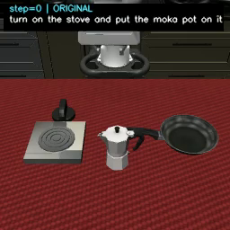
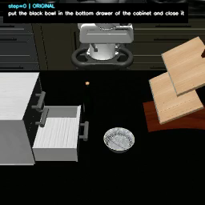
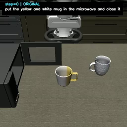
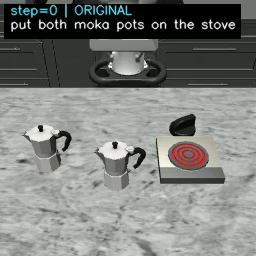
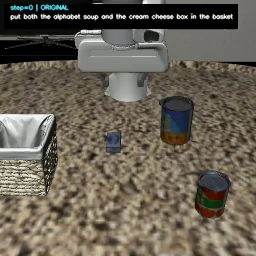
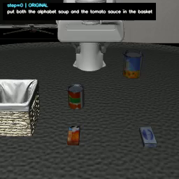
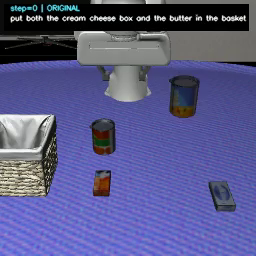
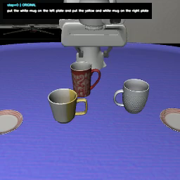
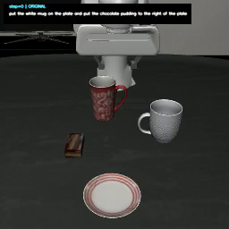
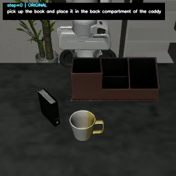

# LIBERO-10 用例整改与扩充

本文按任务逐条梳理当前 catalog（`dataset/current`，共 **287** 条定义）的 rollback / 完成边界用例：

窗口分布、参数口径、逐用例的时机 / 对象 / 位置 / 姿态 / 机制 / 结果，以及每个任务的 baseline 信息（首帧截图、场景物体、baseline 视频、完成步数）。

## 一、整改前总览（原始表，保留）

| 任务 | 场景 | early | mid | later | all_done | 合计 |
| --- | --- | ---: | ---: | ---: | ---: | ---: |
| 00 | 开炉灶并放摩卡壶 | 1 | 3 | 1 | 3 | **8** |
| 01 | 黑碗入底抽屉并关上 | 10 | 20 | 8 | 3 | **41** |
| 02 | 黄白杯入微波炉并关上 | 10 | 20 | 8 | 3 | **41** |
| 03 | 两个摩卡壶放炉灶 | 9 | 18 | 6 | 3 | **36** |
| 04 | 汤+芝士入篮 | 2 | 23 | 9 | 3 | **37** |
| 05 | 汤+酱入篮 | 2 | 23 | 9 | 3 | **37** |
| 06 | 芝士+黄油入篮 | 2 | 23 | 9 | 3 | **37** |
| 07 | 两杯分别放盘 | 8 | 20 | 6 | 3 | **37** |
| 08 | 杯+布丁放盘 | 2 | 23 | 9 | 3 | **37** |
| 09 | 书入桌面收纳架 | — | — | — | 1 | **1** |
| **合计** | | **46** | **173** | **65** | **28** | |

**口径差异（先读）：**上表合计 **312** 条，是整改前口径，= 当前 catalog 288 条 ＋ 24 条已退役的 progress-pulse 用例（pulse-5 / pulse-20 / pulse-60 × 任务 01–08）。
另外矩阵 `docs/case-matrix-current.md` 的 327 条还包含 15 条 pose-control 用例（任务 01/04/07 各 5 条），它们从未进入 catalog，只有矩阵行与历史运行证据。

## 二、当前 catalog 总览（本文明细的依据）

| 任务 | 场景 | early | mid | later | all_done | 合计 |
| --- | --- | ---: | ---: | ---: | ---: | ---: |
| 00 | 打开灶台并把摩卡壶放上去 | 1 | 5 | 1 | 3 | **10** |
| 01 | 把黑碗放进柜子底抽屉并关上 | 10 | 14 | 8 | 3 | **35** |
| 02 | 把黄白马克杯放进微波炉并关上 | 10 | 17 | 8 | 3 | **38** |
| 03 | 把两个摩卡壶都放到灶面上 | 9 | 15 | 6 | 3 | **33** |
| 04 | 把字母汤罐头和奶油奶酪盒放进篮子 | 2 | 20 | 9 | 3 | **34** |
| 05 | 把字母汤罐头和番茄酱放进篮子 | 2 | 20 | 9 | 3 | **34** |
| 06 | 把奶油奶酪盒和黄油放进篮子 | 2 | 20 | 9 | 3 | **34** |
| 07 | 把白杯放到左盘、黄白马克杯放到右盘 | 8 | 17 | 6 | 3 | **34** |
| 08 | 把白杯放到盘上、巧克力布丁放到盘子右侧 | 2 | 20 | 9 | 3 | **34** |
| 09 | 拿起书并放进收纳架后格 | 0 | 0 | 0 | 1 | **1** |
| **合计** | | **46** | **148** | **65** | **28** | **287** |

## 三、参数说明

### Window（扰动时机）

时机＝用例声明的任务窗口与它对应的**原生里程碑事件**，事件由 runtime profile 的 milestones 判定：

| window | 原生事件 | 语义 | 用例数 |
| --- | --- | --- | ---: |
| early | `enter_first_subgoal_completed` | 第一个子目标刚完成 | 45 |
| early | `enter_next_subgoal_approach` | 开始接近下一个子目标 | 1 |
| mid | `enter_next_subgoal_approach` | 开始接近下一个子目标 | 117 |
| mid | `enter_post_completion_retreat` | 第一个子目标完成后撤离 | 31 |
| later | `enter_next_subgoal_lift` | 下一个子目标抬升阶段 | 49 |
| later | `enter_x3a_actuation` | 第二阶段搬运动作执行中 | 16 |
| all_done | `enter_next_subgoal_completed` | 全部子目标完成（任务成功） | 28 |

### Delay（注入延迟）

触发事件命中后，等待多少个控制步再写入扰动（0 表示同一步立即注入，不是推断值）：

- **delay = 0**：276 条
- **delay = 10**：11 条

### Object（被回滚对象）

被撤销的实体来自 `rollback_target`：显式用例写明谓词或关节（如 `akita_black_bowl_1`、`flat_stove_1_button`）；
rollback-battery 的用例写 `profile-resolved`，由运行时按**实际完成顺序**解析到首个已完成子目标的 actor，注入前该关系必须仍为真。

### Position（回滚位置）

| 机制 | 回滚位置语义 | 用例数 |
| --- | --- | ---: |
| `apply_episode_initial_offset` | 回合初始位姿 + 带符号水平偏移；负向朝机械手、正向远离，全部贴支撑面 | 143 |
| `restore_episode_initial_pose` | 回到该物体回合初始位姿（原始落点） | 44 |
| `displace_from_completed_pose` | 已完成位姿原地，只改朝向（可含抬升） | 37 |
| `restore_native_relation_set` | 把 1–2 个原生目标的端点原子地恢复到回合初始值（自由体位姿 / 关节初始角） | 18 |
| `displace_to_relation_boundary` | 关系翻转点两侧的最近合法位姿（精度与搜索上限按用例声明） | 16 |
| `restore_container_above_pose` | 抬到容器开口正上方悬停（净空按用例声明） | 12 |
| `revert_articulation_goal` | 把关节驱动回未开启一侧 | 7 |
| `translate_relation_pair` | 被撤销物体与参照物按同一向量平移，关系应保持 | 5 |
| `displace_reference_object` | 只移动参照物（篮子 / 盘子），被撤销物体不动 | 5 |

### Posture（回滚姿态）

- **保持朝向**：250 条（位置类扰动，注入不改变物体朝向）
- **主动旋转**：37 条（`displace_from_completed_pose` 姿态探针，绕水平轴 15/30/45/60° 倾转或绕竖直轴 180° 旋转）

### Result（结果口径）

`result` 列由两段证据拼成，两段含义不同，不能混用：

1. **原生预检**（全部用例都有记录，合并最新已验证批次（v17 全量 + T03/T04–08 选择器复验 + r05 重标定复验））：

| 预检状态 | 含义 | 当前条数 |
| --- | --- | ---: |
| `preflight_rollback` | 预检通过（关系真→假） | 221 |
| `preflight_relation_preserving_probe` | 真值探针（关系保持） | 37 |
| `preflight_control` | 对照（关系保持，不进恢复率分母） | 12 |
| `requires_dynamic_drive_validation` | 需动态验证：关节驱动须独立 episode | 7 |
| `preflight_rejected` | preflight_rejected | 6 |
| `trigger_not_reached` | 未触发：该 episode 未出现完成事件 | 4 |

2. **live 评测（仅任务 01/04）**：`runs/eval-task01-04-400`（78 条全量、400 步上限）与 `runs/eval-task0104-all-done-postsuccess`
（6 条 all_done 用例加 `--post-success-window` 的补跑）。措辞为「注入有效·已恢复 / 注入有效·未恢复 / 注入无效：<原因> / 未触发」。

未跑 live 的任务只在 result 列给出预检结论，**预检通过不等于模型恢复**。

### 补充用例的展开规则（本文约定）

**姿态类与位置类补充用例一律按 `early / mid / later` 三个时机各展开一遍，不在单一时机取样**；条数 = 变体数 × 3。
姿态类的变体集统一为 5 个：前翻 90° / 后翻 90° / 左翻 90° / 右翻 90° / 扣住（绕水平轴 180°）。

| 任务 | 家族 | 变体 × 时机 | 条数 |
| --- | --- | --- | ---: |
| 01 | 贴壁侧立探针（左内壁/右内壁/后挡板） | 3 × 3 | 9 |
| 01 | 初始位姿 × 侧翻 | 5 × 3 | 15 |
| 02 | 初始位姿 × 侧翻 | 5 × 3 | 15 |
| 03 | 初始位姿 × 侧翻（动态选择器指定 s1 壶） | 5 × 3 | 15 |
| 03 | 灶面上倾倒（探针） | 5 × 3 | 15 |
| 04/05/06 | s1 物体初始位姿 × 侧翻 | 5 × 3 | 各 15 |
| 04/05/06 | 篮内倾倒（探针） | 5 × 3 | 各 15 |
| 04/05/06 | basket 位移（小幅/大幅） | 2 × 3 | 各 6 |
| 07 | s1 杯子侧翻 | 5 × 3 | 15 |
| 07 | 左盘（s1 目标）位移（小幅/大幅） | 2 × 3 | 6 |
| 07 | 右盘（s2 目标）位移 | 1 × 3 | 3 |
| 08 | s1 杯子侧翻 | 5 × 3 | 15 |
| 08 | 盘子位移（小幅/大幅） | 2 × 3 | 6 |
| 08 | 两物体同时位移 | 1 × 3 | 3 |

**判定口径分界（决定姿态族是探针还是真失效）**：`In` / `On` 都会先做 `target.check_contact(obj)`，而两种 target 的差别是决定性的——

| target 类型 | `check_contact` | `check_contain` | 姿态扰动能否翻假 |
| --- | --- | --- | --- |
| **site（区域）** | **恒为真**（源码注释：no dynamics for site objects） | 只比 body 原点 | **不能** → 姿态族必为探针 |
| **body（物体）** | `env.check_contact(...)` **真实接触** | 只比 body 原点 | **能**（破坏接触即翻假）→ 必须实测 |

逐任务核对（S1 的判定目标）：

| 任务 | S1 判定目标 | 类型 | 姿态族性质 |
| --- | --- | --- | --- |
| 01 | `white_cabinet_1_bottom_region` | site | 必为探针 |
| 02 | `microwave_1_heating_region` | site | 必为探针 |
| 03 | `flat_stove_1_cook_region` | site | 必为探针 |
| 04 / 05 / 06 | `basket_1_contain_region` | site | 必为探针 |
| **07** | `plate_1` | **body** | **可能翻假，必须实测** |
| **08** | S1 `plate_1`；S2 `living_room_table_plate_right_region` | body / site | S1 需实测；S2 探针 |
| 00 | S1 是关节；S2 `flat_stove_1_cook_region` | site | 探针 |
| 09 | `desk_caddy_1_back_contain_region` | site | 探针 |

**跨任务的同一个机制缺口**：“把物体写到**另一个物体或区域所在的位置**”现有 9 种 `state_change` 都做不到，
以下家族的用例都依赖它，建议**一次实现、多处复用**：

- 00 的 A 类（把平底锅放到灶台加热区上）；
- 01 的占用类（把场景里的 `wine_bottle_1` 放进抽屉）；
- 04 / 05 / 06 的占用类（把第二个物体放进篮子）；
- 07 / 08 的 ⭐ 极端用例（把 s1 物体放到 s2 的目标盘 / 右侧区域）。

在这些家族的用例里，凡是“在目标位置改姿态”的档位都要先跑一次原生预检实测真值，再决定 `relation_only`（探针）还是 `relation_then_resume`（要求失效）。
## 四、用例说明（逐任务）

### 4.1 libero_10/00 — Turn on the stove and put the moka pot on it

**打开灶台并把摩卡壶放上去**

#### 4.1.1 baseline 信息

- **baseline 信息**：Pi05 / seed 0 / 600 步预算 / 完成 **255 步**且成功（v12 live 批次基线预检）
- **baseline 视频**：[LIBERO_10_T0__baseline_seed0.mp4](../runs/progress-live-20261014-v12/libero-10-00-progress-both-goals-all-done/pi05_20261014_115103/videos/LIBERO_10_T0__baseline_seed0.mp4)
- **运行定位符 / BDDL**：T0 / `KITCHEN_SCENE3_turn_on_the_stove_and_put_the_moka_pot_on_it_table_1.bddl`
- **子任务（执行顺序）**：**S1** = Turn on the stove `(Turnon flat_stove_1)`；**S2** = put the moka pot on the stove `(On moka_pot_1 flat_stove_1_cook_region)`
- **场景中的物体**：
  - BDDL `:objects`（可动物体）：chefmate_8_frypan_1、moka_pot_1
  - BDDL `:obj_of_interest`（任务相关，含夹具）：moka_pot_1、flat_stove_1
  - runtime profile 角色实体（实现解析用）：flat_stove_1、flat_stove_1_button、moka_pot_1
- **首帧截图**（该 baseline 视频第 0 帧）：

#### 4.1.2 现有用例（10 条，全部来自当前 catalog）

| case_id | s1 → s2 | window | delay | object | position | posture | 机制 / 评测语义 | result |
| --- | --- | --- | ---: | --- | --- | --- | --- | --- |
| `libero-10-00-moka-pot-stove-rollback-s1-s2-early-p1` | Turn on the stove → put the moka pot on the stove | early | 10 | 灶台旋钮（flat_stove_1_button） | 关节回退到未开启一侧（turnoff） | 保持（不改变朝向） | `revert_articulation_goal`；要求失效→需恢复 | 需动态验证：关节驱动须独立 episode |
| `libero-10-00-moka-pot-stove-rollback-s1-s2-mid-p1` | Turn on the stove → put the moka pot on the stove | mid | 0 | 灶台旋钮（flat_stove_1_button） | 关节回退到未开启一侧（turnoff） | 保持（不改变朝向） | `revert_articulation_goal`；要求失效→需恢复 | 需动态验证：关节驱动须独立 episode |
| `libero-10-00-progress-function-boundary-inside-mid` | Turn on the stove → put the moka pot on the stove | mid | 0 | 灶台旋钮（flat_stove_1_button） | 关节回退到未开启一侧（turnoff） | 保持（不改变朝向） | `revert_articulation_goal`；关系保持对照（不进恢复率分母） | 需动态验证：关节驱动须独立 episode |
| `libero-10-00-progress-function-boundary-outside-mid` | Turn on the stove → put the moka pot on the stove | mid | 0 | 灶台旋钮（flat_stove_1_button） | 关节回退到未开启一侧（turnoff） | 保持（不改变朝向） | `revert_articulation_goal`；要求失效→需恢复 | 需动态验证：关节驱动须独立 episode |
| `libero-10-00-progress-knob-quarter-mid` | Turn on the stove → put the moka pot on the stove | mid | 0 | 灶台旋钮（flat_stove_1_button） | 关节回退到未开启一侧（turnoff） | 保持（不改变朝向） | `revert_articulation_goal`；关系保持对照（不进恢复率分母） | 需动态验证：关节驱动须独立 episode |
| `libero-10-00-progress-knob-three-quarter-mid` | Turn on the stove → put the moka pot on the stove | mid | 0 | 灶台旋钮（flat_stove_1_button） | 关节回退到未开启一侧（turnoff） | 保持（不改变朝向） | `revert_articulation_goal`；要求失效→需恢复 | 需动态验证：关节驱动须独立 episode |
| `libero-10-00-moka-pot-stove-rollback-s1-s2-later-p1` | Turn on the stove → put the moka pot on the stove | later | 0 | 灶台旋钮（flat_stove_1_button） | 关节回退到未开启一侧（turnoff） | 保持（不改变朝向） | `revert_articulation_goal`；要求失效→需恢复 | 需动态验证：关节驱动须独立 episode |
| `libero-10-00-progress-initial-pose-all-done` | Turn on the stove → put the moka pot on the stove | all_done | 0 | 摩卡壶1（moka_pot_1） | 回合初始位姿（原始落点） | 保持（不改变朝向） | `restore_episode_initial_pose`；要求失效→需恢复 | 预检通过（关系真→假） |
| `libero-10-00-progress-both-goals-all-done` | Turn on the stove → put the moka pot on the stove | all_done | 0 | 摩卡壶1（moka_pot_1）、灶台（flat_stove_1） | 原生关系集回到回合初始端点：摩卡壶1（moka_pot_1）、灶台（flat_stove_1） | 保持（不改变朝向） | `restore_native_relation_set`；要求失效→需恢复 | 预检通过（关系真→假） |
| `libero-10-00-progress-other-goal-all-done` | Turn on the stove → put the moka pot on the stove | all_done | 0 | 灶台（flat_stove_1） | 原生关系集回到回合初始端点：灶台（flat_stove_1） | 保持（不改变朝向） | `restore_native_relation_set`；要求失效→需恢复 | 预检通过（关系真→假） |

#### 4.1.3 补充用例（C 类已落地，B/A 待实现）

任务 00 的 goal 是 `(:goal (And (Turnon flat_stove_1) (On moka_pot_1 flat_stove_1_cook_region)))`，
执行顺序 **S1 = Turn on the stove** → **S2 = put the moka pot on the stove**。现有 10 条用例：3 条撤销 S1（关节回退）、5 条完成后边界族、2 条新增的旋钮 position 梯度。

**为什么这样设计（可行性依据）**

- **stove 不可移动，是固定夹具**：

- runtime BDDL 的 `:objects` 只声明可动物体：`chefmate_8_frypan_1`、`moka_pot_1`，**stove 不在其中**；
- stove 只有**旋钮关节**被建模：profile 的 `articulation_target` → `flat_stove_1_button`（MuJoCo `button` hinge 关节），`articulation.success_threshold_rad = 0.5`；
- 参照物用例的 assumptions 明确：`the basket and the plate are movable objects, unlike the cabinet, microwave and stove, which are fixed fixtures`；
- 回滚处理器写的是**自由体 qpos**（`apply_lift` 直接改 `qpos[address:address+3]`），夹具没有自由关节，写不进去。

结论：**“把 stove 位移”这类用例不可实现**。位移只能作用于可动物体（`moka_pot_1`、`chefmate_8_frypan_1`），
或者通过移动参照物/注入占用物来改变 S1 目标区域的环境状态。stove 能改的只有它的旋钮关节。

- **运行时处理器（已实现，catalog 尚未使用）**：

| 处理器 | 能力 | catalog 现状 |
| --- | --- | --- |
| `scene_object_inject` | 把场景物注入到指定位姿 | 未使用 |
| `dynamic_scene_object_occupancy` | 目标区域占用扰动，`obstacle_class` 可选 `fixed_obstacle` / `movable_object` / `door_sweep_blockage` | 未使用 |
| `rigid_body_displace` | 位移刚体，支持 `direction_frame`(world/task)、稳定性校验步数 | 未使用（见 `docs/defect-t0405-penetration.md` 第六节） |
| `articulation_setback` | 关节回退到指定量 | **已用**（任务 00 现有 3 条 + 完成边界 2 条） |
| `completed_subgoal_rollback` | 已完成子目标撤销 | 已用（其余全部用例） |

- **建议新增用例**（按 C → B → A 顺序实现）：

**类别 A：S2 执行期间把平底锅放到 stove 上**（占用 S1 的目标区域，S1 本身仍为真）

| case_id | window | delay | object | position | posture | 机制 | 评测语义 |
| --- | --- | ---: | --- | --- | --- | --- | --- |
| `libero-10-00-pan-on-stove-early` | early | 0 | 平底锅 `chefmate_8_frypan_1` | 放到 `flat_stove_1_cook_region`（与摩卡壶同一加热区） | 保持 | `scene_object_inject` | 关系保持对照（S1 不撤销，测 S2 能否完成） |
| `libero-10-00-pan-on-stove-mid` | mid | 0 | 同上 | 同上 | 保持 | `scene_object_inject` | 同上 |
| `libero-10-00-pan-on-stove-later` | later | 0 | 同上 | 同上 | 保持 | `scene_object_inject` | 同上 |
| `libero-10-00-pan-occupancy-mid` | mid | 0 | 同上 | 加热区占用（用 `obstacle_class=movable_object` + 净空参数） | 保持 | `dynamic_scene_object_occupancy` | 同上（与上一行是同一扰动的两种实现口径） |

**类别 B：S2 期间 / 关火之后位移**（位移目标必须是可动物体）

| case_id | window | delay | object | position | posture | 机制 | 评测语义 |
| --- | --- | ---: | --- | --- | --- | --- | --- |
| `libero-10-00-moka-displace-mid` | mid | 0 | 摩卡壶 `moka_pot_1` | 从当前位姿水平推开（`direction_frame: world`，位移向量待标定） | 保持 | `rigid_body_displace` | 要求失效→需恢复（若已放置则 `On` 翻假） |
| `libero-10-00-moka-displace-later` | later | 0 | 同上 | 同上 | 保持 | `rigid_body_displace` | 同上 |
| `libero-10-00-pan-displace-mid` | mid | 0 | 平底锅 | 从灶面移开 | 保持 | `rigid_body_displace` | 关系保持对照（环境干扰被移除的对照） |
| `libero-10-00-knob-off-then-displace-mid` | mid | 0 | 旋钮＋摩卡壶 | 先关节回退（S1 翻假）再位移壶 | 保持 | 复合：`articulation_setback` + `rigid_body_displace` | 要求失效→需恢复（两个目标同时为假） |

**类别 C：旋钮 position 梯度 —— 已落地（2 条新用例，k10 档已有）**

| case_id | setback | 量程占比 | 状态 |
| --- | ---: | --- | --- |
| `libero-10-00-progress-knob-quarter-mid` | 0.5 rad | ≈1/4 | **新增**，语义 `relation_holds_control`（预期仍为真，待 live 实测确认） |
| `libero-10-00-moka-pot-stove-rollback-s1-s2-mid-p1` | 1.0 rad | ≈1/2（即“关一半”） | 已有用例，已验证能把 `(Turnon flat_stove_1)` 翻假 |
| `libero-10-00-progress-knob-three-quarter-mid` | 1.5 rad | ≈3/4 | **新增**，语义 `relation_then_resume`（要求失效→需恢复） |

> **关键实现事实**：旋钮是铰链、量程 `[-0.005, 2.1] rad`、原生阈值 `success_threshold_rad = 0.5`；bridge 里 `_ARTICULATION_SETBACK_LABELS` 把 setback 值硬映射到 runtime 变体名，未知值直接报 `no runtime variant for joint setback`，所以新增档位必须同时补 runtime 变体。
> 代码注释给出的标定结论是“需要接近半量程的回退才能撤销 Turnon”——**1.0 rad 档本身就是“关一半”**，因此本条不是新增维度，而是围绕它补两侧梯度。

> **运行环境**：新用例绑定到新建的 `runs/validation-runtime-20261015-v15`（在冻结的 v14 基础上，给 `hv_articulation_goal_rollback` 的 k 族补 `k05/k15` 两档：setback 0.5/1.5 rad、`position_tolerance` 0.05、事件映射照抄 k10）。
> **已完成校验**：`build_current_catalog.py` 重建 catalog（288 → **290**）、`validate-dataset` 通过、`check-manifest` 通过、两条新用例的绑定分别解析到 `l3_grid_art_k05_mid` / `l3_grid_art_k15_mid`。
> **标定状态**：原生预检对关节驱动只登记 `requires_dynamic_drive_validation`（不做端点写入），所以“k05 是否仍为真”只能由 live episode 实测；标定运行 `runs/eval-knob-grid-20261016`（400 步、含视频）正在产出。

- **实现依赖**：

1. **profile 角色**：`libero_10_t0.yaml` 目前只有 `moka_pot_1`、`flat_stove_1`、`flat_stove_1_button`，**没有任何 frypan 角色**；A 类与 B 类的平底锅用例必须先加 `pan_1: {kind: body, name: chefmate_8_frypan_1}`。
2. **catalog 机制扩展**：`state_change.kind` 目前只有 9 种、且只桥接到 `completed_subgoal_rollback` / `articulation_setback`；A/B 类需要新增 kind 并同步 `schemas/rollback-case.v1.schema.json`、`dataset/current/templates.yaml`、`src/libero_rollback/runtime.py` 的桥接映射。
3. **C 类：已部分落地**。v15 的 k 族现有 `k05`(0.5 rad)、`k10`(1.0)、`k15`(1.5) 三档，其中 1/4 与 3/4 档已成用例（`progress-knob-quarter-mid`、`progress-knob-three-quarter-mid`），1/2 档由既有 `k10` 家族覆盖；桥接表注释记录 `k05` 仍在阈值（0.5 rad）之上属控制档、`k10`/`k15` 翻假。剩余缺口是**更细的位置梯度与控制档标定**，需在 v15 上继续补变体并跑原生预检实测。
4. **复合注入**：`knob-off-then-displace` 需要同一 episode 内两次**不同**注入；现有 transient/pulse 协议只支持“复位”式第二次写入，需确认 runtime 是否支持，否则拆成两条独立用例。
5. **A 类语义口径**：占用扰动不撤销 S1，现有 `expected_evaluation_semantics` 里最接近的是 `relation_holds_control`；若要区分“环境占用”建议扩一个语义值，并在模板里声明保护目标。

### 4.2 libero_10/01 — Put the black bowl in the bottom drawer and close it

**把黑碗放进柜子底抽屉并关上**

#### 4.2.1 baseline 信息

- **baseline 信息**：Pi05 / seed 0 / 600 步预算 / 完成 **328 步**且成功（v12 live 批次基线预检）
- **baseline 视频**：[LIBERO_10_T33__baseline_seed0.mp4](../runs/progress-live-20261014-v12/libero-10-01-progress-both-goals-all-done/pi05_20261014_115629/videos/LIBERO_10_T33__baseline_seed0.mp4)
- **运行定位符 / BDDL**：T33 / `KITCHEN_SCENE4_put_the_black_bowl_in_the_bottom_drawer_of_the_cabinet_and_close_it.bddl`
- **子任务（执行顺序）**：**S1** = put the black bowl in the bottom drawer `(In akita_black_bowl_1 white_cabinet_1_bottom_region)`；**S2** = close the drawer `(Close white_cabinet_1_bottom_region)`
- **场景中的物体**：
  - BDDL `:objects`（可动物体）：akita_black_bowl_1、wine_bottle_1
  - BDDL `:obj_of_interest`（任务相关，含夹具）：akita_black_bowl_1、white_cabinet_1
  - runtime profile 角色实体（实现解析用）：akita_black_bowl_1、white_cabinet_1_cabinet_bottom
- **首帧截图**（该 baseline 视频第 0 帧）：

#### 4.2.2 现有用例（35 条，全部来自当前 catalog）

| case_id | s1 → s2 | window | delay | object | position | posture | 机制 / 评测语义 | result |
| --- | --- | --- | ---: | --- | --- | --- | --- | --- |
| `libero-10-01-black-rollback-s1-early-offset-n3` | put the black bowl in the bottom drawer → close the drawer | early | 0 | 按 profile 动态解析（首个已完成子目标） | 初始位姿 + 朝机械手方向小幅水平偏移（贴支撑面） | 保持（不改变朝向） | `apply_episode_initial_offset`；要求失效→需恢复 | 预检通过（关系真→假）｜live400：注入有效·未恢复 |
| `libero-10-01-black-rollback-s1-early-offset-n5` | put the black bowl in the bottom drawer → close the drawer | early | 0 | 按 profile 动态解析（首个已完成子目标） | 初始位姿 + 朝机械手方向中幅水平偏移（贴支撑面） | 保持（不改变朝向） | `apply_episode_initial_offset`；要求失效→需恢复 | 预检通过（关系真→假）｜live400：注入有效·未恢复 |
| `libero-10-01-black-rollback-s1-early-offset-n8` | put the black bowl in the bottom drawer → close the drawer | early | 0 | 按 profile 动态解析（首个已完成子目标） | 初始位姿 + 朝机械手方向大幅水平偏移（贴支撑面） | 保持（不改变朝向） | `apply_episode_initial_offset`；要求失效→需恢复 | 预检通过（关系真→假）｜live400：注入有效·未恢复 |
| `libero-10-01-black-rollback-s1-early-offset-p10` | put the black bowl in the bottom drawer → close the drawer | early | 0 | 按 profile 动态解析（首个已完成子目标） | 初始位姿 + 远离机械手方向大幅水平偏移（贴支撑面） | 保持（不改变朝向） | `apply_episode_initial_offset`；要求失效→需恢复 | 预检通过（关系真→假）｜live400：注入有效·未恢复 |
| `libero-10-01-black-rollback-s1-early-offset-p3` | put the black bowl in the bottom drawer → close the drawer | early | 0 | 按 profile 动态解析（首个已完成子目标） | 初始位姿 + 远离机械手方向小幅水平偏移（贴支撑面） | 保持（不改变朝向） | `apply_episode_initial_offset`；要求失效→需恢复 | 预检通过（关系真→假）｜live400：注入有效·未恢复 |
| `libero-10-01-black-rollback-s1-early-offset-p5` | put the black bowl in the bottom drawer → close the drawer | early | 0 | 按 profile 动态解析（首个已完成子目标） | 初始位姿 + 远离机械手方向中幅水平偏移（贴支撑面） | 保持（不改变朝向） | `apply_episode_initial_offset`；要求失效→需恢复 | 预检通过（关系真→假）｜live400：注入有效·未恢复 |
| `libero-10-01-black-bowl-drawer-rollback-s1-early-above` | put the black bowl in the bottom drawer → close the drawer | early | 10 | 黑碗（akita_black_bowl_1） | 容器开口正上方悬停（净空 0.05 m） | 保持（不改变朝向） | `restore_container_above_pose`；要求失效→需恢复 | 预检通过（关系真→假）｜live400：注入有效·未恢复 |
| `libero-10-01-black-rollback-s1-early-container-above` | put the black bowl in the bottom drawer → close the drawer | early | 0 | 按 profile 动态解析（首个已完成子目标） | 容器开口正上方悬停（净空 0.05 m） | 保持（不改变朝向） | `restore_container_above_pose`；要求失效→需恢复 | 预检通过（关系真→假）｜live400：注入有效·未恢复 |
| `libero-10-01-black-bowl-drawer-place-early-t0` | put the black bowl in the bottom drawer → close the drawer | early | 0 | 黑碗（akita_black_bowl_1） | 回合初始位姿（原始落点） | 保持（不改变朝向） | `restore_episode_initial_pose`；要求失效→需恢复 | 预检通过（关系真→假）｜live400：注入有效·未恢复 |
| `libero-10-01-black-rollback-s1-early-initial-pose` | put the black bowl in the bottom drawer → close the drawer | early | 0 | 按 profile 动态解析（首个已完成子目标） | 回合初始位姿（原始落点） | 保持（不改变朝向） | `restore_episode_initial_pose`；要求失效→需恢复 | 预检通过（关系真→假）｜live400：注入有效·未恢复 |
| `libero-10-01-black-bowl-drawer-rollback-s1-mid-offset-n3` | put the black bowl in the bottom drawer → close the drawer | mid | 0 | 黑碗（akita_black_bowl_1） | 初始位姿 + 朝机械手方向小幅水平偏移（贴支撑面） | 保持（不改变朝向） | `apply_episode_initial_offset`；要求失效→需恢复 | 预检通过（关系真→假）｜live400：注入有效·未恢复 |
| `libero-10-01-black-bowl-drawer-rollback-s1-mid-offset-n5` | put the black bowl in the bottom drawer → close the drawer | mid | 0 | 黑碗（akita_black_bowl_1） | 初始位姿 + 朝机械手方向中幅水平偏移（贴支撑面） | 保持（不改变朝向） | `apply_episode_initial_offset`；要求失效→需恢复 | 预检通过（关系真→假）｜live400：注入有效·未恢复 |
| `libero-10-01-black-bowl-drawer-rollback-s1-mid-offset-p3` | put the black bowl in the bottom drawer → close the drawer | mid | 0 | 黑碗（akita_black_bowl_1） | 初始位姿 + 远离机械手方向小幅水平偏移（贴支撑面） | 保持（不改变朝向） | `apply_episode_initial_offset`；要求失效→需恢复 | 预检通过（关系真→假）｜live400：注入有效·未恢复 |
| `libero-10-01-black-bowl-drawer-rollback-s1-mid-offset-p5` | put the black bowl in the bottom drawer → close the drawer | mid | 0 | 黑碗（akita_black_bowl_1） | 初始位姿 + 远离机械手方向中幅水平偏移（贴支撑面） | 保持（不改变朝向） | `apply_episode_initial_offset`；要求失效→需恢复 | 预检通过（关系真→假）｜live400：注入有效·未恢复 |
| `libero-10-01-black-rollback-s1-mid-offset-n3` | put the black bowl in the bottom drawer → close the drawer | mid | 0 | 按 profile 动态解析（首个已完成子目标） | 初始位姿 + 朝机械手方向小幅水平偏移（贴支撑面） | 保持（不改变朝向） | `apply_episode_initial_offset`；要求失效→需恢复 | 预检通过（关系真→假）｜live400：注入有效·未恢复 |
| `libero-10-01-black-rollback-s1-mid-offset-n5` | put the black bowl in the bottom drawer → close the drawer | mid | 0 | 按 profile 动态解析（首个已完成子目标） | 初始位姿 + 朝机械手方向中幅水平偏移（贴支撑面） | 保持（不改变朝向） | `apply_episode_initial_offset`；要求失效→需恢复 | 预检通过（关系真→假）｜live400：注入有效·未恢复 |
| `libero-10-01-progress-roll15-completed-mid` | put the black bowl in the bottom drawer → close the drawer | mid | 0 | 按 profile 动态解析（首个已完成子目标） | 已完成位姿（先抬升 0.04 m），仅改朝向、位置不变 | 绕水平轴倾转 15° | `displace_from_completed_pose`；仅判定关系（真值探针） | 真值探针（关系保持）｜live400：注入有效·已恢复 |
| `libero-10-01-progress-yaw180-completed-mid` | put the black bowl in the bottom drawer → close the drawer | mid | 0 | 按 profile 动态解析（首个已完成子目标） | 已完成位姿，仅改朝向、位置不变 | 绕竖直轴旋转 180° | `displace_from_completed_pose`；仅判定关系（真值探针） | 真值探针（关系保持）｜live400：注入有效·已恢复 |
| `libero-10-01-progress-boundary-inside-mid` | put the black bowl in the bottom drawer → close the drawer | mid | 0 | 按 profile 动态解析（首个已完成子目标） | 关系边界最近合法位姿（关系仍为真一侧） | 保持（不改变朝向） | `displace_to_relation_boundary`；关系保持对照（不进恢复率分母） | 预检拒绝：找不到合法原生边界配对｜live400：注入无效：找不到合法原生边界配对 |
| `libero-10-01-progress-boundary-outside-mid` | put the black bowl in the bottom drawer → close the drawer | mid | 0 | 按 profile 动态解析（首个已完成子目标） | 关系边界最近合法位姿（关系已翻假一侧） | 保持（不改变朝向） | `displace_to_relation_boundary`；要求失效→需恢复 | 预检拒绝：找不到合法原生边界配对｜live400：注入无效：找不到合法原生边界配对 |
| `libero-10-01-black-bowl-drawer-rollback-s1-mid-above` | put the black bowl in the bottom drawer → close the drawer | mid | 0 | 黑碗（akita_black_bowl_1） | 容器开口正上方悬停（净空 0.05 m） | 保持（不改变朝向） | `restore_container_above_pose`；要求失效→需恢复 | 预检通过（关系真→假）｜live400：注入有效·未恢复 |
| `libero-10-01-black-rollback-s1-mid-container-above` | put the black bowl in the bottom drawer → close the drawer | mid | 0 | 按 profile 动态解析（首个已完成子目标） | 容器开口正上方悬停（净空 0.05 m） | 保持（不改变朝向） | `restore_container_above_pose`；要求失效→需恢复 | 预检通过（关系真→假）｜live400：注入有效·未恢复 |
| `libero-10-01-black-rollback-s1-mid-initial-pose` | put the black bowl in the bottom drawer → close the drawer | mid | 0 | 按 profile 动态解析（首个已完成子目标） | 回合初始位姿（原始落点） | 保持（不改变朝向） | `restore_episode_initial_pose`；要求失效→需恢复 | 预检通过（关系真→假）｜live400：注入有效·未恢复 |
| `libero-10-01-progress-repeat-after-recovery-mid` | put the black bowl in the bottom drawer → close the drawer | mid | 0 | 按 profile 动态解析（首个已完成子目标） | 回合初始位姿（原始落点） | 保持（不改变朝向） | `restore_episode_initial_pose`；要求失效→需恢复 | 预检通过（关系真→假）｜live400：注入有效·未恢复 |
| `libero-10-01-black-bowl-drawer-rollback-s1-later-offset-n8` | put the black bowl in the bottom drawer → close the drawer | later | 0 | 黑碗（akita_black_bowl_1） | 初始位姿 + 朝机械手方向大幅水平偏移（贴支撑面） | 保持（不改变朝向） | `apply_episode_initial_offset`；要求失效→需恢复 | 预检通过（关系真→假）｜live400：注入有效·未恢复 |
| `libero-10-01-black-bowl-drawer-rollback-s1-later-offset-p10` | put the black bowl in the bottom drawer → close the drawer | later | 0 | 黑碗（akita_black_bowl_1） | 初始位姿 + 远离机械手方向大幅水平偏移（贴支撑面） | 保持（不改变朝向） | `apply_episode_initial_offset`；要求失效→需恢复 | 预检通过（关系真→假）｜live400：注入有效·未恢复 |
| `libero-10-01-black-bowl-drawer-rollback-s1-later-offset-p8` | put the black bowl in the bottom drawer → close the drawer | later | 0 | 黑碗（akita_black_bowl_1） | 初始位姿 + 远离机械手方向大幅水平偏移（贴支撑面） | 保持（不改变朝向） | `apply_episode_initial_offset`；要求失效→需恢复 | 预检通过（关系真→假）｜live400：注入有效·未恢复 |
| `libero-10-01-black-bowl-drawer-rollback-s1-later-offset-r05` | put the black bowl in the bottom drawer → close the drawer | later | 0 | 黑碗（akita_black_bowl_1） | 初始位姿 + 斜向（朝机械手、侧偏最大）大幅水平偏移（贴支撑面） | 保持（不改变朝向） | `apply_episode_initial_offset`；要求失效→需恢复 | 预检通过（关系真→假）｜live400：注入无效：接触受保护物体 |
| `libero-10-01-black-rollback-s1-later-offset-n3` | put the black bowl in the bottom drawer → close the drawer | later | 0 | 按 profile 动态解析（首个已完成子目标） | 初始位姿 + 朝机械手方向小幅水平偏移（贴支撑面） | 保持（不改变朝向） | `apply_episode_initial_offset`；要求失效→需恢复 | 预检通过（关系真→假）｜live400：注入有效·未恢复 |
| `libero-10-01-black-bowl-drawer-rollback-s1-later-above` | put the black bowl in the bottom drawer → close the drawer | later | 0 | 黑碗（akita_black_bowl_1） | 容器开口正上方悬停（净空 0.05 m） | 保持（不改变朝向） | `restore_container_above_pose`；要求失效→需恢复 | 预检通过（关系真→假）｜live400：注入有效·未恢复 |
| `libero-10-01-black-rollback-s1-later-container-above` | put the black bowl in the bottom drawer → close the drawer | later | 0 | 按 profile 动态解析（首个已完成子目标） | 容器开口正上方悬停（净空 0.05 m） | 保持（不改变朝向） | `restore_container_above_pose`；要求失效→需恢复 | 预检通过（关系真→假）｜live400：注入有效·未恢复 |
| `libero-10-01-black-rollback-s1-later-initial-pose` | put the black bowl in the bottom drawer → close the drawer | later | 0 | 按 profile 动态解析（首个已完成子目标） | 回合初始位姿（原始落点） | 保持（不改变朝向） | `restore_episode_initial_pose`；要求失效→需恢复 | 预检通过（关系真→假）｜live400：注入有效·未恢复 |
| `libero-10-01-progress-initial-pose-all-done` | put the black bowl in the bottom drawer → close the drawer | all_done | 0 | 按 profile 动态解析（首个已完成子目标） | 回合初始位姿（原始落点） | 保持（不改变朝向） | `restore_episode_initial_pose`；要求失效→需恢复 | 预检通过（关系真→假）｜live400：注入有效·未恢复 |
| `libero-10-01-progress-both-goals-all-done` | put the black bowl in the bottom drawer → close the drawer | all_done | 0 | 黑碗（akita_black_bowl_1）、柜子底抽屉（white_cabinet_1_bottom_region） | 原生关系集回到回合初始端点：黑碗（akita_black_bowl_1）、柜子底抽屉（white_cabinet_1_bottom_region） | 保持（不改变朝向） | `restore_native_relation_set`；要求失效→需恢复 | 预检拒绝：接触受保护物体｜live400：注入无效：接触受保护物体 |
| `libero-10-01-progress-other-goal-all-done` | put the black bowl in the bottom drawer → close the drawer | all_done | 0 | 柜子底抽屉（white_cabinet_1_bottom_region） | 原生关系集回到回合初始端点：柜子底抽屉（white_cabinet_1_bottom_region） | 保持（不改变朝向） | `restore_native_relation_set`；要求失效→需恢复 | 预检拒绝：连带改动了受保护目标｜live400：注入无效：连带改动了受保护目标 |

#### 4.2.3 补充用例（建议，待实现）

**可行性依据（已核对实现）**

- **`(In bowl drawer_region)` 是单点位置判定**：`In(o, r)` = `r.check_contact(o) and r.check_contain(o)`；区域是 site 时 `check_contact` 恒为真（源码注释：There is no dynamics for site objects, so we return true all the time），`check_contain` 只把物体的 **body 原点**送进 `in_box(site_pos, site_mat, body_xpos)` 比较，**不看朝向、不看包围盒**。
  → 所以**纯姿态改变不会让 S1 失效**，姿态用例只能作“关系保持对照 / 真值探针”。这也解释了现有 roll30/45/60 的拒绝理由是**穿透**而不是“未失效”。
- **抽屉判定盒的真实尺寸**（`white_cabinet.xml` 的 `bottom_region` site，绕 Y 轴 90°）：世界系半尺寸 ≈ (0.102, 0.076, 0.030) → **可用高度只有约 6 cm**（z 0.017→0.077），内腔 x≈20 cm、y≈15 cm；关节 `bottom_level` 沿 +Y 滑动，行程 [−0.16, 0.01]。
  → 抽屉内倾转必然撞壁/撞顶（实测 roll30/45/60 穿透 11.1 / 20.2 / 13.7 mm 被拒），而**桌面原位翻转不会**。
- **可用变体（无需改 overlay）**：`apply_episode_initial_offset`（`offset_m: [0,0,0]`）+ `orientation_axis_angle` 走 severity `pose` → `l2_grid_pose_{early|mid|later}`；v15 的 `hv_completed_subgoal_rollback_grid` 已定义这三个变体（**没有 `_after`**），且 T33 现有 roll15/30/45/60/yaw180 就在用 `l2_grid_pose_mid`。

**族 1：贴壁侧立探针**（预期关系保持，测“姿态改变不误报失效”）

| case_id | window | delay | object | position | posture | 机制 | 评测语义 |
| --- | --- | ---: | --- | --- | --- | --- | --- |
| `libero-10-01-bowl-lean-left-wall-mid` | mid | 0 | 黑碗 | 已完成位姿 + 贴左内壁（x≈−0.09） | 侧立 90°（绕水平轴） | `displace_from_completed_pose` | 关系保持对照 |
| `libero-10-01-bowl-lean-right-wall-mid` | mid | 0 | 黑碗 | 已完成位姿 + 贴右内壁（x≈+0.09） | 侧立 90°（绕水平轴） | `displace_from_completed_pose` | 关系保持对照 |
| `libero-10-01-bowl-lean-back-panel-mid` | mid | 0 | 黑碗 | 已完成位姿 + 贴后挡板（y≈−0.06） | 侧立 90°（绕水平轴） | `displace_from_completed_pose` | 关系保持对照 |

贴壁是**接触**不是穿透，因此比现有“自由倾转”探针更稳（5 mm 预算内）；三个位置对应模型里真实存在的三块内壁/挡板（左右侧壁 x≈±0.10、后挡板 y≈−0.075）。

**族 2：初始位姿 × 侧翻形态**（预期失效；位置回到桌面原点，姿态为侧翻/倒扣）

| case_id | window | delay | object | position | posture | 机制 | 评测语义 |
| --- | --- | ---: | --- | --- | --- | --- | --- |
| `libero-10-01-bowl-initial-tip-forward-mid` | mid | 0 | 黑碗 | 回合初始位姿（桌面原位，原点出盒） | 前翻 90°（绕 x 轴） | `apply_episode_initial_offset`（offset 0）+ 朝向 | 要求失效→需恢复 |
| `libero-10-01-bowl-initial-tip-backward-mid` | mid | 0 | 黑碗 | 同上 | 后翻 90°（绕 x 轴反向） | 同上 | 要求失效→需恢复 |
| `libero-10-01-bowl-initial-tip-left-mid` | mid | 0 | 黑碗 | 同上 | 左翻 90°（绕 y 轴） | 同上 | 要求失效→需恢复 |
| `libero-10-01-bowl-initial-tip-right-mid` | mid | 0 | 黑碗 | 同上 | 右翻 90°（绕 y 轴反向） | 同上 | 要求失效→需恢复 |
| `libero-10-01-bowl-initial-upside-down-mid` | mid | 0 | 黑碗 | 同上 | **扣住**：绕水平轴 180° | 同上 | 要求失效→需恢复 |

评测价值：① 失效判定正确性（原点回到桌面、出判定盒）；② **翻倒物体的重抓取**——现有 78 条用例完全没有覆盖“抓起侧翻/倒扣的碗再放回抽屉”；③ 补上**位置×姿态的组合**维度（现有 40 条姿态用例全部是“已完成位姿原地、只改姿态”，且都属 progress 家族）。

**族 3：撤销已完成的 S2（暂缓，留作后续）**

- 想法：抽屉**关好之后**（`enter_articulation_completed`）再把关节回退，单独撤销已完成的 S2；T33 的 `s02/s03/s05` 三档在 v15 都已定义（`s*`/`h*` 共 18 个槽位目前未被任何 catalog 用例使用）。
- **暂缓原因**：现有评测在任务成功的瞬间就终止 episode，`enter_articulation_completed` 之后没有可注入的步——与任务 00/04 的 all_done 用例实测到的问题是同一类（当时靠 runtime 的 `--post-success-window` 才拿到注入窗口）。
- 前置条件：① 确认 `enter_articulation_completed` 在终止前到达；② 用 post-success window 保留注入与观测窗口；③ 确认 v15 的 `libero_10_t33.yaml` 绑定是否登记 art 模板（v15 里用的是 `libero_10_t33_x3b_articulation_setback`，未见 `hv_articulation_goal_rollback`）。

**实现依赖与下一步**

1. **族 1**：无需新机制；唯一要实测的是**贴壁位姿能否落在 5 mm 穿透预算内**（runtime 的净空搜索只做 +Z 抬升，贴壁位姿需手写）。
2. **族 2**：无需新机制、无需改 overlay；唯一要实测的是**绑定是否接受 `offset_m=[0,0,0]` + `orientation_axis_angle` 的组合**（矩阵时代的 15 条 pose-control 用过同一形状，但它们当前不在 catalog）。
3. 建议各取 1 条做最小验证（`-lean-right-wall-mid`、`-initial-upside-down-mid`），跑原生预检确认真值与穿透预算后再铺齐。
### 4.3 libero_10/02 — Put the yellow and white mug in the microwave and close it

**把黄白马克杯放进微波炉并关上**

#### 4.3.1 baseline 信息

- **baseline 信息**：Pi05 / seed 0 / 600 步预算 / 完成 **231 步**且成功（v12 live 批次基线预检）
- **baseline 视频**：[LIBERO_10_T78__baseline_seed0.mp4](../runs/progress-live-20261014-v12/libero-10-02-progress-both-goals-all-done/pi05_20261014_120315/videos/LIBERO_10_T78__baseline_seed0.mp4)
- **运行定位符 / BDDL**：T78 / `KITCHEN_SCENE6_put_the_yellow_and_white_mug_in_the_microwave_and_close_it.bddl`
- **子任务（执行顺序）**：**S1** = put the yellow and white mug in the microwave `(In white_yellow_mug_1 microwave_1_heating_region)`；**S2** = close the microwave `(Close microwave_1)`
- **场景中的物体**：
  - BDDL `:objects`（可动物体）：porcelain_mug_1、white_yellow_mug_1
  - BDDL `:obj_of_interest`（任务相关，含夹具）：white_yellow_mug_1、microwave_1
  - runtime profile 角色实体（实现解析用）：microwave_1、microwave_1_microdoorroot、white_yellow_mug_1
- **首帧截图**（该 baseline 视频第 0 帧）：

#### 4.3.2 现有用例（38 条，全部来自当前 catalog）

| case_id | s1 → s2 | window | delay | object | position | posture | 机制 / 评测语义 | result |
| --- | --- | --- | ---: | --- | --- | --- | --- | --- |
| `libero-10-02-yellow-rollback-s1-early-offset-n3` | put the yellow and white mug in the microwave → close the microwave | early | 0 | 按 profile 动态解析（首个已完成子目标） | 初始位姿 + 朝机械手方向小幅水平偏移（贴支撑面） | 保持（不改变朝向） | `apply_episode_initial_offset`；要求失效→需恢复 | 预检通过（关系真→假） |
| `libero-10-02-yellow-rollback-s1-early-offset-n5` | put the yellow and white mug in the microwave → close the microwave | early | 0 | 按 profile 动态解析（首个已完成子目标） | 初始位姿 + 朝机械手方向中幅水平偏移（贴支撑面） | 保持（不改变朝向） | `apply_episode_initial_offset`；要求失效→需恢复 | 预检通过（关系真→假） |
| `libero-10-02-yellow-rollback-s1-early-offset-n8` | put the yellow and white mug in the microwave → close the microwave | early | 0 | 按 profile 动态解析（首个已完成子目标） | 初始位姿 + 朝机械手方向大幅水平偏移（贴支撑面） | 保持（不改变朝向） | `apply_episode_initial_offset`；要求失效→需恢复 | 预检通过（关系真→假） |
| `libero-10-02-yellow-rollback-s1-early-offset-p10` | put the yellow and white mug in the microwave → close the microwave | early | 0 | 按 profile 动态解析（首个已完成子目标） | 初始位姿 + 远离机械手方向大幅水平偏移（贴支撑面） | 保持（不改变朝向） | `apply_episode_initial_offset`；要求失效→需恢复 | 预检通过（关系真→假） |
| `libero-10-02-yellow-rollback-s1-early-offset-p3` | put the yellow and white mug in the microwave → close the microwave | early | 0 | 按 profile 动态解析（首个已完成子目标） | 初始位姿 + 远离机械手方向小幅水平偏移（贴支撑面） | 保持（不改变朝向） | `apply_episode_initial_offset`；要求失效→需恢复 | 预检通过（关系真→假） |
| `libero-10-02-yellow-rollback-s1-early-offset-p8` | put the yellow and white mug in the microwave → close the microwave | early | 0 | 按 profile 动态解析（首个已完成子目标） | 初始位姿 + 远离机械手方向大幅水平偏移（贴支撑面） | 保持（不改变朝向） | `apply_episode_initial_offset`；要求失效→需恢复 | 预检通过（关系真→假） |
| `libero-10-02-yellow-rollback-s1-early-container-above` | put the yellow and white mug in the microwave → close the microwave | early | 0 | 按 profile 动态解析（首个已完成子目标） | 容器开口正上方悬停（净空 0.05 m） | 保持（不改变朝向） | `restore_container_above_pose`；要求失效→需恢复 | 预检通过（关系真→假） |
| `libero-10-02-yellow-white-mug-microwave-rollback-s1-early-above` | put the yellow and white mug in the microwave → close the microwave | early | 10 | 黄白马克杯（white_yellow_mug_1） | 容器开口正上方悬停（净空 0.05 m） | 保持（不改变朝向） | `restore_container_above_pose`；要求失效→需恢复 | 预检通过（关系真→假） |
| `libero-10-02-yellow-rollback-s1-early-initial-pose` | put the yellow and white mug in the microwave → close the microwave | early | 0 | 按 profile 动态解析（首个已完成子目标） | 回合初始位姿（原始落点） | 保持（不改变朝向） | `restore_episode_initial_pose`；要求失效→需恢复 | 预检通过（关系真→假） |
| `libero-10-02-yellow-white-mug-microwave-place-early-t0` | put the yellow and white mug in the microwave → close the microwave | early | 0 | 黄白马克杯（white_yellow_mug_1） | 回合初始位姿（原始落点） | 保持（不改变朝向） | `restore_episode_initial_pose`；要求失效→需恢复 | 预检通过（关系真→假） |
| `libero-10-02-yellow-rollback-s1-mid-offset-n3` | put the yellow and white mug in the microwave → close the microwave | mid | 0 | 按 profile 动态解析（首个已完成子目标） | 初始位姿 + 朝机械手方向小幅水平偏移（贴支撑面） | 保持（不改变朝向） | `apply_episode_initial_offset`；要求失效→需恢复 | 预检通过（关系真→假） |
| `libero-10-02-yellow-rollback-s1-mid-offset-n5` | put the yellow and white mug in the microwave → close the microwave | mid | 0 | 按 profile 动态解析（首个已完成子目标） | 初始位姿 + 朝机械手方向中幅水平偏移（贴支撑面） | 保持（不改变朝向） | `apply_episode_initial_offset`；要求失效→需恢复 | 预检通过（关系真→假） |
| `libero-10-02-yellow-white-mug-microwave-rollback-s1-mid-offset-n3` | put the yellow and white mug in the microwave → close the microwave | mid | 0 | 黄白马克杯（white_yellow_mug_1） | 初始位姿 + 朝机械手方向小幅水平偏移（贴支撑面） | 保持（不改变朝向） | `apply_episode_initial_offset`；要求失效→需恢复 | 预检通过（关系真→假） |
| `libero-10-02-yellow-white-mug-microwave-rollback-s1-mid-offset-n5` | put the yellow and white mug in the microwave → close the microwave | mid | 0 | 黄白马克杯（white_yellow_mug_1） | 初始位姿 + 朝机械手方向中幅水平偏移（贴支撑面） | 保持（不改变朝向） | `apply_episode_initial_offset`；要求失效→需恢复 | 预检通过（关系真→假） |
| `libero-10-02-yellow-white-mug-microwave-rollback-s1-mid-offset-p3` | put the yellow and white mug in the microwave → close the microwave | mid | 0 | 黄白马克杯（white_yellow_mug_1） | 初始位姿 + 远离机械手方向小幅水平偏移（贴支撑面） | 保持（不改变朝向） | `apply_episode_initial_offset`；要求失效→需恢复 | 预检通过（关系真→假） |
| `libero-10-02-yellow-white-mug-microwave-rollback-s1-mid-offset-p5` | put the yellow and white mug in the microwave → close the microwave | mid | 0 | 黄白马克杯（white_yellow_mug_1） | 初始位姿 + 远离机械手方向中幅水平偏移（贴支撑面） | 保持（不改变朝向） | `apply_episode_initial_offset`；要求失效→需恢复 | 预检通过（关系真→假） |
| `libero-10-02-progress-roll15-completed-mid` | put the yellow and white mug in the microwave → close the microwave | mid | 0 | 按 profile 动态解析（首个已完成子目标） | 已完成位姿（先抬升 0.04 m），仅改朝向、位置不变 | 绕水平轴倾转 15° | `displace_from_completed_pose`；仅判定关系（真值探针） | 真值探针（关系保持） |
| `libero-10-02-progress-roll30-completed-mid` | put the yellow and white mug in the microwave → close the microwave | mid | 0 | 按 profile 动态解析（首个已完成子目标） | 已完成位姿（先抬升 0.08 m），仅改朝向、位置不变 | 绕水平轴倾转 30° | `displace_from_completed_pose`；仅判定关系（真值探针） | 真值探针（关系保持） |
| `libero-10-02-progress-roll45-completed-mid` | put the yellow and white mug in the microwave → close the microwave | mid | 0 | 按 profile 动态解析（首个已完成子目标） | 已完成位姿（先抬升 0.12 m），仅改朝向、位置不变 | 绕水平轴倾转 45° | `displace_from_completed_pose`；仅判定关系（真值探针） | 真值探针（关系保持） |
| `libero-10-02-progress-roll60-completed-mid` | put the yellow and white mug in the microwave → close the microwave | mid | 0 | 按 profile 动态解析（首个已完成子目标） | 已完成位姿（先抬升 0.16 m），仅改朝向、位置不变 | 绕水平轴倾转 60° | `displace_from_completed_pose`；仅判定关系（真值探针） | 真值探针（关系保持） |
| `libero-10-02-progress-yaw180-completed-mid` | put the yellow and white mug in the microwave → close the microwave | mid | 0 | 按 profile 动态解析（首个已完成子目标） | 已完成位姿，仅改朝向、位置不变 | 绕竖直轴旋转 180° | `displace_from_completed_pose`；仅判定关系（真值探针） | 真值探针（关系保持） |
| `libero-10-02-progress-boundary-inside-mid` | put the yellow and white mug in the microwave → close the microwave | mid | 0 | 按 profile 动态解析（首个已完成子目标） | 关系边界最近合法位姿（关系仍为真一侧） | 保持（不改变朝向） | `displace_to_relation_boundary`；关系保持对照（不进恢复率分母） | 对照（关系保持，不进恢复率分母） |
| `libero-10-02-progress-boundary-outside-mid` | put the yellow and white mug in the microwave → close the microwave | mid | 0 | 按 profile 动态解析（首个已完成子目标） | 关系边界最近合法位姿（关系已翻假一侧） | 保持（不改变朝向） | `displace_to_relation_boundary`；要求失效→需恢复 | 预检通过（关系真→假） |
| `libero-10-02-yellow-rollback-s1-mid-container-above` | put the yellow and white mug in the microwave → close the microwave | mid | 0 | 按 profile 动态解析（首个已完成子目标） | 容器开口正上方悬停（净空 0.05 m） | 保持（不改变朝向） | `restore_container_above_pose`；要求失效→需恢复 | 预检通过（关系真→假） |
| `libero-10-02-yellow-white-mug-microwave-rollback-s1-mid-above` | put the yellow and white mug in the microwave → close the microwave | mid | 0 | 黄白马克杯（white_yellow_mug_1） | 容器开口正上方悬停（净空 0.05 m） | 保持（不改变朝向） | `restore_container_above_pose`；要求失效→需恢复 | 预检通过（关系真→假） |
| `libero-10-02-progress-repeat-after-recovery-mid` | put the yellow and white mug in the microwave → close the microwave | mid | 0 | 按 profile 动态解析（首个已完成子目标） | 回合初始位姿（原始落点） | 保持（不改变朝向） | `restore_episode_initial_pose`；要求失效→需恢复 | 预检通过（关系真→假） |
| `libero-10-02-yellow-rollback-s1-mid-initial-pose` | put the yellow and white mug in the microwave → close the microwave | mid | 0 | 按 profile 动态解析（首个已完成子目标） | 回合初始位姿（原始落点） | 保持（不改变朝向） | `restore_episode_initial_pose`；要求失效→需恢复 | 预检通过（关系真→假） |
| `libero-10-02-yellow-rollback-s1-later-offset-n3` | put the yellow and white mug in the microwave → close the microwave | later | 0 | 按 profile 动态解析（首个已完成子目标） | 初始位姿 + 朝机械手方向小幅水平偏移（贴支撑面） | 保持（不改变朝向） | `apply_episode_initial_offset`；要求失效→需恢复 | 预检通过（关系真→假） |
| `libero-10-02-yellow-white-mug-microwave-rollback-s1-later-offset-n8` | put the yellow and white mug in the microwave → close the microwave | later | 0 | 黄白马克杯（white_yellow_mug_1） | 初始位姿 + 朝机械手方向大幅水平偏移（贴支撑面） | 保持（不改变朝向） | `apply_episode_initial_offset`；要求失效→需恢复 | 预检通过（关系真→假） |
| `libero-10-02-yellow-white-mug-microwave-rollback-s1-later-offset-p10` | put the yellow and white mug in the microwave → close the microwave | later | 0 | 黄白马克杯（white_yellow_mug_1） | 初始位姿 + 远离机械手方向大幅水平偏移（贴支撑面） | 保持（不改变朝向） | `apply_episode_initial_offset`；要求失效→需恢复 | 预检通过（关系真→假） |
| `libero-10-02-yellow-white-mug-microwave-rollback-s1-later-offset-p8` | put the yellow and white mug in the microwave → close the microwave | later | 0 | 黄白马克杯（white_yellow_mug_1） | 初始位姿 + 远离机械手方向大幅水平偏移（贴支撑面） | 保持（不改变朝向） | `apply_episode_initial_offset`；要求失效→需恢复 | 预检通过（关系真→假） |
| `libero-10-02-yellow-white-mug-microwave-rollback-s1-later-offset-r05` | put the yellow and white mug in the microwave → close the microwave | later | 0 | 黄白马克杯（white_yellow_mug_1） | 初始位姿 + 斜向（朝机械手、侧偏最大）大幅水平偏移（贴支撑面） | 保持（不改变朝向） | `apply_episode_initial_offset`；要求失效→需恢复 | 预检通过（关系真→假） |
| `libero-10-02-yellow-rollback-s1-later-container-above` | put the yellow and white mug in the microwave → close the microwave | later | 0 | 按 profile 动态解析（首个已完成子目标） | 容器开口正上方悬停（净空 0.05 m） | 保持（不改变朝向） | `restore_container_above_pose`；要求失效→需恢复 | 预检通过（关系真→假） |
| `libero-10-02-yellow-white-mug-microwave-rollback-s1-later-above` | put the yellow and white mug in the microwave → close the microwave | later | 0 | 黄白马克杯（white_yellow_mug_1） | 容器开口正上方悬停（净空 0.05 m） | 保持（不改变朝向） | `restore_container_above_pose`；要求失效→需恢复 | 预检通过（关系真→假） |
| `libero-10-02-yellow-rollback-s1-later-initial-pose` | put the yellow and white mug in the microwave → close the microwave | later | 0 | 按 profile 动态解析（首个已完成子目标） | 回合初始位姿（原始落点） | 保持（不改变朝向） | `restore_episode_initial_pose`；要求失效→需恢复 | 预检通过（关系真→假） |
| `libero-10-02-progress-initial-pose-all-done` | put the yellow and white mug in the microwave → close the microwave | all_done | 0 | 按 profile 动态解析（首个已完成子目标） | 回合初始位姿（原始落点） | 保持（不改变朝向） | `restore_episode_initial_pose`；要求失效→需恢复 | 预检通过（关系真→假） |
| `libero-10-02-progress-both-goals-all-done` | put the yellow and white mug in the microwave → close the microwave | all_done | 0 | 黄白马克杯（white_yellow_mug_1）、微波炉（microwave_1） | 原生关系集回到回合初始端点：黄白马克杯（white_yellow_mug_1）、微波炉（microwave_1） | 保持（不改变朝向） | `restore_native_relation_set`；要求失效→需恢复 | 预检拒绝：接触受保护物体 |
| `libero-10-02-progress-other-goal-all-done` | put the yellow and white mug in the microwave → close the microwave | all_done | 0 | 微波炉（microwave_1） | 原生关系集回到回合初始端点：微波炉（microwave_1） | 保持（不改变朝向） | `restore_native_relation_set`；要求失效→需恢复 | 预检拒绝：接触受保护物体 |

#### 4.3.3 补充用例（建议，待实现）

**可行性依据（已核对实现）**

- **`In` 同为单点位置判定**：`(In white_yellow_mug_1 microwave_1_heating_region)` 的 region 是 site，`check_contact` 恒为真、`check_contain` 只比较 **body 原点**与盒子的关系——**不看朝向**。所以腔内姿态调整**永远不会让 S1 翻假**。
- **微波炉判定盒的真实尺寸**（`microwave.xml` 的 `heating_region` site，四元数为单位）：size `(0.12, 0.0835, 0.08)` → 世界系 **24 × 16.7 × 16 cm**，腔底 z≈0.012、腔顶 z≈0.178；门是铰链 `microdoorroot`（在 −y 侧），关节 `microjoint` 阈值 −0.005 rad。
- **实测反例**：腔体虽比抽屉高（16 cm vs 6 cm），但 T02 现有 `roll30/45/60` 三条姿态探针**同样因穿透被拒**（`roll15` 与 `yaw180` 通过）——所以“加大腔内倾转角”这条路在本任务上不通。

**A 族：回原点 × 侧翻形态（5 条，预期失效）**

| case_id | window | delay | object | position | posture | 机制 | 评测语义 |
| --- | --- | ---: | --- | --- | --- | --- | --- |
| `libero-10-02-mug-initial-tip-forward-mid` | mid | 0 | 黄白马克杯 | 回合初始位姿（桌面原位，原点出盒） | 前翻 90°（绕 x 轴） | `apply_episode_initial_offset`（offset 0）+ 朝向 | 要求失效→需恢复 |
| `libero-10-02-mug-initial-tip-backward-mid` | mid | 0 | 黄白马克杯 | 同上 | 后翻 90°（绕 x 轴反向） | 同上 | 要求失效→需恢复 |
| `libero-10-02-mug-initial-tip-left-mid` | mid | 0 | 黄白马克杯 | 同上 | 左翻 90°（绕 y 轴） | 同上 | 要求失效→需恢复 |
| `libero-10-02-mug-initial-tip-right-mid` | mid | 0 | 黄白马克杯 | 同上 | 右翻 90°（绕 y 轴反向） | 同上 | 要求失效→需恢复 |
| `libero-10-02-mug-initial-upside-down-mid` | mid | 0 | 黄白马克杯 | 同上 | **扣住**：绕水平轴 180° | 同上 | 要求失效→需恢复 |

与 T01 的差异：杯子有**把手**，所以每个形态还带一个把手朝向（朝门 / 朝内 / 朝上 / 朝下）；把手位置直接影响“翻倒后能否重新抓住”，这是 T02 特有的评测价值。

**明确不做 / 暂缓的方向（及理由）**

- **腔体内姿态补全（不做）**：由上面第一条可知，姿态不改变单点判定 → 对“破坏 S1 的 `In`”零贡献；而现有 `roll30/45/60` 的拒绝也说明加大角度只会换来穿透。
- **门扫掠 / 占位族（不入册）**：用第二只杯子 `porcelain_mug_1` 挡门的扫掠弧（`obstacle_class: door_sweep_blockage`）确实会有效果，但它破坏的是 **S2（关门）**，不破坏 **S1 的 `In`**——本数据集的扰动定义是“撤销已完成子目标”，所以这类环境占用扰动不属于 rollback 家族，另行归档。
- **撤销已完成的 S2（暂缓）**：门虚掩档 `h02/h04/h07`（0.02/0.04/0.07 rad）在 v15 已定义，阈值 −0.005 rad 使三档都会翻假；但现阶段任务成功即终止 episode，等 post-success window 问题解决后再做（与 T01 的 s* 族同批）。

**E：边界族的垂直搜索修复（进行中）**

- **缺口**：T01/T02 的 `boundary-inside` / `boundary-outside` 四条用例在原生预检里全部被拒（`NO_LEGAL_NATIVE_RELATION_BOUNDARY_PAIR`）。根因是 `rollback_extensions.resolve_relation_boundary` 只沿 **±x / ±y 四条水平射线**找“界内合法点 → 界外合法点”，封闭抽屉/微波炉里每条射线都撞壁。
- **修法**：在新建的 `runs/validation-runtime-20261016-v16`（v15 副本）里加**垂直回退**——水平四条射线找不到配对时，再沿 +Z 试一条；`search_directions` 可显式固定模式（`horizontal_then_vertical` 默认 / `vertical_only`），证据里新增 `search_directions` 字段。
- **验证结果（2026-10-16，`runs/eval-boundary-vertical-20261016`，v16、400 步、rc=0）**：
  - **T02 成功**：`progress-boundary-inside-mid` → `preflight_control`（关系保持，作对照）、`progress-boundary-outside-mid` → `preflight_rollback`（关系真→假）——两条从“被拒”变成“一控一失效”，边界维度在本任务上救活。
  - **T01 仍失败**：抽屉两条依旧 `NO_LEGAL_NATIVE_RELATION_BOUNDARY_PAIR`，说明封闭抽屉里连垂直射线也拿不到合法配对（推测是抽屉上方/腔内的中间抽屉或壁面让“出盒但仍合法”的位姿不存在）。需要换思路：从容器开口外侧起搜、或分段路径（先沿开口方向移出再判定）。
  - 同批快照还显示：v15/v16 下 T02 的 `roll30/45/60` 由“穿透被拒”变为 `preflight_relation_preserving_probe`（与 v12 时代的结论不同），T02 另有 3 条 later 位移档新出现穿透拒绝——说明 v15 之后的 overlay 与 v12 基线不可直接横向比较。

### 4.4 libero_10/03 — Put both moka pots on the stove

**把两个摩卡壶都放到灶面上**

#### 4.4.1 baseline 信息

- **baseline 信息**：Pi05 / seed 1 / 600 步预算 / 完成 **409 步**且成功（v12 live 批次基线预检）
- **baseline 视频**：[LIBERO_10_T133__baseline_seed1.mp4](../runs/progress-live-20261014-v12/libero-10-03-progress-both-goals-all-done/pi05_20261014_120913/videos/LIBERO_10_T133__baseline_seed1.mp4)
- **运行定位符 / BDDL**：T133 / `KITCHEN_SCENE8_put_both_moka_pots_on_the_stove_tb_20.bddl`
- **子任务（执行顺序）**：**S1** = put the first moka pot on the stove `(On moka_pot_1 flat_stove_1_cook_region)`；**S2** = put the second moka pot on the stove `(On moka_pot_2 flat_stove_1_cook_region)`
- **场景中的物体**：
  - BDDL `:objects`（可动物体）：moka_pot_1、moka_pot_2
  - BDDL `:obj_of_interest`（任务相关，含夹具）：moka_pot_1、moka_pot_2、flat_stove_1
  - runtime profile 角色实体（实现解析用）：flat_stove_1、moka_pot_1、moka_pot_2
- **首帧截图**（该 baseline 视频第 0 帧）：

#### 4.4.2 现有用例（33 条，全部来自当前 catalog）

| case_id | s1 → s2 | window | delay | object | position | posture | 机制 / 评测语义 | result |
| --- | --- | --- | ---: | --- | --- | --- | --- | --- |
| `libero-10-03-first-rollback-s1-early-offset-n3` | put the first moka pot on the stove → put the second moka pot on the stove | early | 0 | 按 profile 动态解析（首个已完成子目标） | 初始位姿 + 朝机械手方向小幅水平偏移（贴支撑面） | 保持（不改变朝向） | `apply_episode_initial_offset`；要求失效→需恢复 | 预检通过（关系真→假） |
| `libero-10-03-first-rollback-s1-early-offset-n5` | put the first moka pot on the stove → put the second moka pot on the stove | early | 0 | 按 profile 动态解析（首个已完成子目标） | 初始位姿 + 朝机械手方向中幅水平偏移（贴支撑面） | 保持（不改变朝向） | `apply_episode_initial_offset`；要求失效→需恢复 | 预检通过（关系真→假） |
| `libero-10-03-first-rollback-s1-early-offset-n8` | put the first moka pot on the stove → put the second moka pot on the stove | early | 0 | 按 profile 动态解析（首个已完成子目标） | 初始位姿 + 朝机械手方向大幅水平偏移（贴支撑面） | 保持（不改变朝向） | `apply_episode_initial_offset`；要求失效→需恢复 | 预检通过（关系真→假） |
| `libero-10-03-first-rollback-s1-early-offset-p10` | put the first moka pot on the stove → put the second moka pot on the stove | early | 0 | 按 profile 动态解析（首个已完成子目标） | 初始位姿 + 远离机械手方向大幅水平偏移（贴支撑面） | 保持（不改变朝向） | `apply_episode_initial_offset`；要求失效→需恢复 | 预检通过（关系真→假） |
| `libero-10-03-first-rollback-s1-early-offset-p3` | put the first moka pot on the stove → put the second moka pot on the stove | early | 0 | 按 profile 动态解析（首个已完成子目标） | 初始位姿 + 远离机械手方向小幅水平偏移（贴支撑面） | 保持（不改变朝向） | `apply_episode_initial_offset`；要求失效→需恢复 | 预检通过（关系真→假） |
| `libero-10-03-first-rollback-s1-early-offset-p5` | put the first moka pot on the stove → put the second moka pot on the stove | early | 0 | 按 profile 动态解析（首个已完成子目标） | 初始位姿 + 远离机械手方向中幅水平偏移（贴支撑面） | 保持（不改变朝向） | `apply_episode_initial_offset`；要求失效→需恢复 | 预检通过（关系真→假） |
| `libero-10-03-first-rollback-s1-early-offset-r05` | put the first moka pot on the stove → put the second moka pot on the stove | early | 0 | 按 profile 动态解析（首个已完成子目标） | 初始位姿 + 朝机械手方向中幅水平偏移（贴支撑面） | 保持（不改变朝向） | `apply_episode_initial_offset`；要求失效→需恢复 | 预检通过（关系真→假） |
| `libero-10-03-first-moka-pot-stove-place-early-t0` | put the first moka pot on the stove → put the second moka pot on the stove | early | 0 | selected_relation_actor | 回合初始位姿（原始落点） | 保持（不改变朝向） | `restore_episode_initial_pose`；要求失效→需恢复 | 预检通过（关系真→假） |
| `libero-10-03-first-rollback-s1-early-initial-pose` | put the first moka pot on the stove → put the second moka pot on the stove | early | 0 | 按 profile 动态解析（首个已完成子目标） | 回合初始位姿（原始落点） | 保持（不改变朝向） | `restore_episode_initial_pose`；要求失效→需恢复 | 预检通过（关系真→假） |
| `libero-10-03-first-moka-pot-stove-rollback-s1-mid-offset-n3` | put the first moka pot on the stove → put the second moka pot on the stove | mid | 0 | selected_relation_actor | 初始位姿 + 朝机械手方向小幅水平偏移（贴支撑面） | 保持（不改变朝向） | `apply_episode_initial_offset`；要求失效→需恢复 | 预检通过（关系真→假） |
| `libero-10-03-first-moka-pot-stove-rollback-s1-mid-offset-n5` | put the first moka pot on the stove → put the second moka pot on the stove | mid | 0 | selected_relation_actor | 初始位姿 + 朝机械手方向中幅水平偏移（贴支撑面） | 保持（不改变朝向） | `apply_episode_initial_offset`；要求失效→需恢复 | 预检通过（关系真→假） |
| `libero-10-03-first-moka-pot-stove-rollback-s1-mid-offset-p3` | put the first moka pot on the stove → put the second moka pot on the stove | mid | 0 | selected_relation_actor | 初始位姿 + 远离机械手方向小幅水平偏移（贴支撑面） | 保持（不改变朝向） | `apply_episode_initial_offset`；要求失效→需恢复 | 预检通过（关系真→假） |
| `libero-10-03-first-moka-pot-stove-rollback-s1-mid-offset-p5` | put the first moka pot on the stove → put the second moka pot on the stove | mid | 0 | selected_relation_actor | 初始位姿 + 远离机械手方向中幅水平偏移（贴支撑面） | 保持（不改变朝向） | `apply_episode_initial_offset`；要求失效→需恢复 | 预检通过（关系真→假） |
| `libero-10-03-first-rollback-s1-mid-offset-n3` | put the first moka pot on the stove → put the second moka pot on the stove | mid | 0 | 按 profile 动态解析（首个已完成子目标） | 初始位姿 + 朝机械手方向小幅水平偏移（贴支撑面） | 保持（不改变朝向） | `apply_episode_initial_offset`；要求失效→需恢复 | 预检通过（关系真→假） |
| `libero-10-03-first-rollback-s1-mid-offset-n5` | put the first moka pot on the stove → put the second moka pot on the stove | mid | 0 | 按 profile 动态解析（首个已完成子目标） | 初始位姿 + 朝机械手方向中幅水平偏移（贴支撑面） | 保持（不改变朝向） | `apply_episode_initial_offset`；要求失效→需恢复 | 预检通过（关系真→假） |
| `libero-10-03-progress-roll15-completed-mid` | put the first moka pot on the stove → put the second moka pot on the stove | mid | 0 | 按 profile 动态解析（首个已完成子目标） | 已完成位姿（先抬升 0.04 m），仅改朝向、位置不变 | 绕水平轴倾转 15° | `displace_from_completed_pose`；仅判定关系（真值探针） | 真值探针（关系保持） |
| `libero-10-03-progress-roll30-completed-mid` | put the first moka pot on the stove → put the second moka pot on the stove | mid | 0 | 按 profile 动态解析（首个已完成子目标） | 已完成位姿（先抬升 0.08 m），仅改朝向、位置不变 | 绕水平轴倾转 30° | `displace_from_completed_pose`；仅判定关系（真值探针） | 真值探针（关系保持） |
| `libero-10-03-progress-roll45-completed-mid` | put the first moka pot on the stove → put the second moka pot on the stove | mid | 0 | 按 profile 动态解析（首个已完成子目标） | 已完成位姿（先抬升 0.12 m），仅改朝向、位置不变 | 绕水平轴倾转 45° | `displace_from_completed_pose`；仅判定关系（真值探针） | 真值探针（关系保持） |
| `libero-10-03-progress-roll60-completed-mid` | put the first moka pot on the stove → put the second moka pot on the stove | mid | 0 | 按 profile 动态解析（首个已完成子目标） | 已完成位姿（先抬升 0.16 m），仅改朝向、位置不变 | 绕水平轴倾转 60° | `displace_from_completed_pose`；仅判定关系（真值探针） | 真值探针（关系保持） |
| `libero-10-03-progress-yaw180-completed-mid` | put the first moka pot on the stove → put the second moka pot on the stove | mid | 0 | 按 profile 动态解析（首个已完成子目标） | 已完成位姿，仅改朝向、位置不变 | 绕竖直轴旋转 180° | `displace_from_completed_pose`；仅判定关系（真值探针） | 真值探针（关系保持） |
| `libero-10-03-progress-boundary-inside-mid` | put the first moka pot on the stove → put the second moka pot on the stove | mid | 0 | 按 profile 动态解析（首个已完成子目标） | 关系边界最近合法位姿（关系仍为真一侧） | 保持（不改变朝向） | `displace_to_relation_boundary`；关系保持对照（不进恢复率分母） | 对照（关系保持，不进恢复率分母） |
| `libero-10-03-progress-boundary-outside-mid` | put the first moka pot on the stove → put the second moka pot on the stove | mid | 0 | 按 profile 动态解析（首个已完成子目标） | 关系边界最近合法位姿（关系已翻假一侧） | 保持（不改变朝向） | `displace_to_relation_boundary`；要求失效→需恢复 | 预检通过（关系真→假） |
| `libero-10-03-first-rollback-s1-mid-initial-pose` | put the first moka pot on the stove → put the second moka pot on the stove | mid | 0 | 按 profile 动态解析（首个已完成子目标） | 回合初始位姿（原始落点） | 保持（不改变朝向） | `restore_episode_initial_pose`；要求失效→需恢复 | 预检通过（关系真→假） |
| `libero-10-03-progress-repeat-after-recovery-mid` | put the first moka pot on the stove → put the second moka pot on the stove | mid | 0 | 按 profile 动态解析（首个已完成子目标） | 回合初始位姿（原始落点） | 保持（不改变朝向） | `restore_episode_initial_pose`；要求失效→需恢复 | 预检通过（关系真→假） |
| `libero-10-03-first-moka-pot-stove-rollback-s1-later-offset-n8` | put the first moka pot on the stove → put the second moka pot on the stove | later | 0 | selected_relation_actor | 初始位姿 + 朝机械手方向大幅水平偏移（贴支撑面） | 保持（不改变朝向） | `apply_episode_initial_offset`；要求失效→需恢复 | 预检通过（关系真→假） |
| `libero-10-03-first-moka-pot-stove-rollback-s1-later-offset-p10` | put the first moka pot on the stove → put the second moka pot on the stove | later | 0 | selected_relation_actor | 初始位姿 + 远离机械手方向大幅水平偏移（贴支撑面） | 保持（不改变朝向） | `apply_episode_initial_offset`；要求失效→需恢复 | 预检通过（关系真→假） |
| `libero-10-03-first-moka-pot-stove-rollback-s1-later-offset-p8` | put the first moka pot on the stove → put the second moka pot on the stove | later | 0 | selected_relation_actor | 初始位姿 + 远离机械手方向大幅水平偏移（贴支撑面） | 保持（不改变朝向） | `apply_episode_initial_offset`；要求失效→需恢复 | 预检通过（关系真→假） |
| `libero-10-03-first-moka-pot-stove-rollback-s1-later-offset-r05` | put the first moka pot on the stove → put the second moka pot on the stove | later | 0 | selected_relation_actor | 初始位姿 + 朝机械手方向中幅水平偏移（贴支撑面） | 保持（不改变朝向） | `apply_episode_initial_offset`；要求失效→需恢复 | 预检通过（关系真→假） |
| `libero-10-03-first-rollback-s1-later-offset-n3` | put the first moka pot on the stove → put the second moka pot on the stove | later | 0 | 按 profile 动态解析（首个已完成子目标） | 初始位姿 + 朝机械手方向小幅水平偏移（贴支撑面） | 保持（不改变朝向） | `apply_episode_initial_offset`；要求失效→需恢复 | 预检通过（关系真→假） |
| `libero-10-03-first-rollback-s1-later-initial-pose` | put the first moka pot on the stove → put the second moka pot on the stove | later | 0 | 按 profile 动态解析（首个已完成子目标） | 回合初始位姿（原始落点） | 保持（不改变朝向） | `restore_episode_initial_pose`；要求失效→需恢复 | 预检通过（关系真→假） |
| `libero-10-03-first-rollback-s1-all_done-offset-n3` | put the first moka pot on the stove → put the second moka pot on the stove | all_done | 0 | 按 profile 动态解析（首个已完成子目标） | 初始位姿 + 朝机械手方向小幅水平偏移（贴支撑面） | 保持（不改变朝向） | `apply_episode_initial_offset`；要求失效→需恢复 | 未触发：该 episode 未出现完成事件 |
| `libero-10-03-progress-both-goals-all-done` | put the first moka pot on the stove → put the second moka pot on the stove | all_done | 0 | 摩卡壶1（moka_pot_1）、摩卡壶2（moka_pot_2） | 原生关系集回到回合初始端点：摩卡壶1（moka_pot_1）、摩卡壶2（moka_pot_2） | 保持（不改变朝向） | `restore_native_relation_set`；要求失效→需恢复 | 未触发：该 episode 未出现完成事件 |
| `libero-10-03-progress-other-goal-all-done` | put the first moka pot on the stove → put the second moka pot on the stove | all_done | 0 | 摩卡壶2（moka_pot_2） | 原生关系集回到回合初始端点：摩卡壶2（moka_pot_2） | 保持（不改变朝向） | `restore_native_relation_set`；要求失效→需恢复 | 未触发：该 episode 未出现完成事件 |

#### 4.4.3 补充用例（建议，待实现）

**可行性依据（已核对实现）**

- **T133 profile 建模了两个子目标**（`moka_pot_1_on_stove`、`moka_pot_2_on_stove`，同一个 `flat_stove_1_cook_region`），角色实体只有 `moka_pot_1`、`moka_pot_2`、`flat_stove_1`。
- **没有 articulation 块**（`articulation: None`，也没有 `articulation_completed` 里程碑）→ 任务 03 **做不了“关火”类关节扰动**；stove 本身是**固定夹具**（不在 BDDL `:objects`）→ **“壶和 stove 一起位移”不可实现**。
- **`On` 与 `In` 同为单点位置判定**（region 是 site：`check_contact` 恒真、`check_contain` 只比 body 原点）→ 壶在灶面上被翻倒**不会**让 `(On moka_pot_x flat_stove_1_cook_region)` 翻假 → 这类只能作**真值探针**。
- **硬编码风险（现存缺陷）**：当前 T03 用例硬编码 `moka_pot_1`。基线预检里 T03 有 **9 条**被拒，理由全是 `target_subgoal ‘moka_pot_1_on_stove’ has not completed`——**先放的不是 1 号壶时就会这样**。
  schema 已支持动态选择器（`selection_id` + `actor: selected_relation_actor`，语义：按实际完成顺序选首个已完成子目标、且注入前必须仍为真），运行时也已在记录 `first_completed_subgoal_id`，但**当前 catalog 使用该选择器的用例数为 0**。

**A 组：s1 的壶回滚到原位 × 倾倒姿态（5 条，预期失效）**——被回滚对象必须是“实际完成 s1 的那个壶”，一律用动态选择器

| case_id | window | delay | object | position | posture | 机制 | 评测语义 |
| --- | --- | ---: | --- | --- | --- | --- | --- |
| `libero-10-03-moka-initial-tip-forward-mid` | mid | 0 | **动态选择器**解析到的 s1 壶 | 回合初始位姿（桌面原位，原点出盒） | 前翻 90° | `apply_episode_initial_offset`（offset 0）+ 朝向 | 要求失效→需恢复 |
| `libero-10-03-moka-initial-tip-backward-mid` | mid | 0 | 同上 | 同上 | 后翻 90° | 同上 | 要求失效→需恢复 |
| `libero-10-03-moka-initial-tip-left-mid` | mid | 0 | 同上 | 同上 | 左翻 90° | 同上 | 要求失效→需恢复 |
| `libero-10-03-moka-initial-tip-right-mid` | mid | 0 | 同上 | 同上 | 右翻 90° | 同上 | 要求失效→需恢复 |
| `libero-10-03-moka-initial-upside-down-mid` | mid | 0 | 同上 | 同上 | 扣住：绕水平轴 180° | 同上 | 要求失效→需恢复 |

**B 组：s1 的壶在灶面上倾倒（5 条，真值探针）**——灶面平坦、几何可行；按单点判定关系保持为真，用于测假阳性

| case_id | window | delay | object | position | posture | 机制 | 评测语义 |
| --- | --- | ---: | --- | --- | --- | --- | --- |
| `libero-10-03-moka-on-stove-tip-forward-mid` | mid | 0 | 动态选择器解析到的 s1 壶 | 已完成位姿（灶面加热区内） | 前翻 90° | `displace_from_completed_pose` | 仅判定关系（探针） |
| `libero-10-03-moka-on-stove-tip-backward-mid` | mid | 0 | 同上 | 同上 | 后翻 90° | 同上 | 仅判定关系（探针） |
| `libero-10-03-moka-on-stove-tip-left-mid` | mid | 0 | 同上 | 同上 | 左翻 90° | 同上 | 仅判定关系（探针） |
| `libero-10-03-moka-on-stove-tip-right-mid` | mid | 0 | 同上 | 同上 | 右翻 90° | 同上 | 仅判定关系（探针） |
| `libero-10-03-moka-on-stove-upside-down-mid` | mid | 0 | 同上 | 同上 | 扣住：180° | 同上 | 仅判定关系（探针） |

**其他可补充维度**

1. **两子目标耦合族（T03 独有，当前空缺）**：只动 s2 的壶（other-goal 家族）、两壶同时位移（both-goals 家族）、两壶都回原位并倾倒。
2. **位置维度**：壶在灶面上的边缘/越界位置——现有偏移家族是相对**回合初始位姿**，而不是相对灶面加热区。
3. **动态选择器对照组**：同一扰动的“显式 pot_1 版”与“动态选择器版”各留一条（仓库惯例：两份来源不合并）。
4. **灶台功能族（需先补 profile）**：goal 含 `(Turnon flat_stove_1)` 但 T133 未建模；要覆盖需按文档补三处声明（`articulation_target` 角色、`articulation` 块、`articulation_completed` 里程碑）并加关节 severity 变体。

### 4.5 libero_10/04 — Put the alphabet soup and cream cheese box in the basket

**把字母汤罐头和奶油奶酪盒放进篮子**

#### 4.5.1 baseline 信息

- **baseline 信息**：Pi05 / seed 0 / 600 步预算 / 完成 **240 步**且成功（v12 补充基线）
- **baseline 视频**：[LIBERO_10_T137__baseline_seed0.mp4](../runs/catalog-native-preflight-20261014-v12/libero-10-04-soup-cheese-basket-rollback-s1-mid-ref-moved/pi05_20261014_122059/videos/LIBERO_10_T137__baseline_seed0.mp4)
- **运行定位符 / BDDL**：T137 / `LIVING_ROOM_SCENE1_put_both_the_alphabet_soup_and_the_cream_cheese_box_in_the_basket_table_1.bddl`
- **子任务（执行顺序）**：**S1** = put the alphabet soup in the basket `(In alphabet_soup_1 basket_1_contain_region)`；**S2** = put the cream cheese box in the basket `(In cream_cheese_1 basket_1_contain_region)`
- **场景中的物体**：
  - BDDL `:objects`（可动物体）：alphabet_soup_1、cream_cheese_1、tomato_sauce_1、ketchup_1、basket_1
  - BDDL `:obj_of_interest`（任务相关，含夹具）：alphabet_soup_1、cream_cheese_1、basket_1
  - runtime profile 角色实体（实现解析用）：alphabet_soup_1、basket_1、cream_cheese_1
- **首帧截图**（该 baseline 视频第 0 帧）：

#### 4.5.2 现有用例（34 条，全部来自当前 catalog）

| case_id | s1 → s2 | window | delay | object | position | posture | 机制 / 评测语义 | result |
| --- | --- | --- | ---: | --- | --- | --- | --- | --- |
| `libero-10-04-soup-cheese-basket-rollback-s1-early-p2` | put the alphabet soup in the basket → put the cream cheese box in the basket | early | 10 | selected_relation_actor | 初始位姿 + 朝机械手方向小幅水平偏移（贴支撑面） | 保持（不改变朝向） | `apply_episode_initial_offset`；要求失效→需恢复 | 预检通过（关系真→假）｜live400：注入有效·未恢复 |
| `libero-10-04-soup-cheese-basket-rollback-s1-early-p1` | put the alphabet soup in the basket → put the cream cheese box in the basket | early | 10 | selected_relation_actor | 回合初始位姿（原始落点） | 保持（不改变朝向） | `restore_episode_initial_pose`；要求失效→需恢复 | 预检通过（关系真→假）｜live400：注入有效·未恢复 |
| `libero-10-04-soup-cheese-basket-rollback-s1-mid-offset-n3` | put the alphabet soup in the basket → put the cream cheese box in the basket | mid | 0 | selected_relation_actor | 初始位姿 + 朝机械手方向小幅水平偏移（贴支撑面） | 保持（不改变朝向） | `apply_episode_initial_offset`；要求失效→需恢复 | 预检通过（关系真→假）｜live400：注入有效·已恢复 |
| `libero-10-04-soup-cheese-basket-rollback-s1-mid-offset-n5` | put the alphabet soup in the basket → put the cream cheese box in the basket | mid | 0 | selected_relation_actor | 初始位姿 + 朝机械手方向中幅水平偏移（贴支撑面） | 保持（不改变朝向） | `apply_episode_initial_offset`；要求失效→需恢复 | 预检通过（关系真→假）｜live400：注入有效·未恢复 |
| `libero-10-04-soup-cheese-basket-rollback-s1-mid-offset-n8` | put the alphabet soup in the basket → put the cream cheese box in the basket | mid | 0 | selected_relation_actor | 初始位姿 + 朝机械手方向大幅水平偏移（贴支撑面） | 保持（不改变朝向） | `apply_episode_initial_offset`；要求失效→需恢复 | 预检通过（关系真→假）｜live400：注入有效·未恢复 |
| `libero-10-04-soup-cheese-basket-rollback-s1-mid-offset-p10` | put the alphabet soup in the basket → put the cream cheese box in the basket | mid | 0 | selected_relation_actor | 初始位姿 + 远离机械手方向大幅水平偏移（贴支撑面） | 保持（不改变朝向） | `apply_episode_initial_offset`；要求失效→需恢复 | 预检通过（关系真→假）｜live400：注入有效·未恢复 |
| `libero-10-04-soup-cheese-basket-rollback-s1-mid-offset-p3` | put the alphabet soup in the basket → put the cream cheese box in the basket | mid | 0 | selected_relation_actor | 初始位姿 + 远离机械手方向小幅水平偏移（贴支撑面） | 保持（不改变朝向） | `apply_episode_initial_offset`；要求失效→需恢复 | 预检通过（关系真→假）｜live400：注入有效·未恢复 |
| `libero-10-04-soup-cheese-basket-rollback-s1-mid-offset-p5` | put the alphabet soup in the basket → put the cream cheese box in the basket | mid | 0 | selected_relation_actor | 初始位姿 + 远离机械手方向中幅水平偏移（贴支撑面） | 保持（不改变朝向） | `apply_episode_initial_offset`；要求失效→需恢复 | 预检通过（关系真→假）｜live400：注入有效·未恢复 |
| `libero-10-04-soup-cheese-basket-rollback-s1-mid-offset-p8` | put the alphabet soup in the basket → put the cream cheese box in the basket | mid | 0 | selected_relation_actor | 初始位姿 + 远离机械手方向大幅水平偏移（贴支撑面） | 保持（不改变朝向） | `apply_episode_initial_offset`；要求失效→需恢复 | 预检通过（关系真→假）｜live400：注入有效·未恢复 |
| `libero-10-04-soup-cheese-basket-rollback-s1-mid-offset-r05` | put the alphabet soup in the basket → put the cream cheese box in the basket | mid | 0 | selected_relation_actor | 初始位姿 + 斜向（朝机械手、侧偏最大）大幅水平偏移（贴支撑面） | 保持（不改变朝向） | `apply_episode_initial_offset`；要求失效→需恢复 | 预检通过（关系真→假）｜live400：注入有效·已恢复 |
| `libero-10-04-soup-cheese-basket-rollback-s1-mid-p2` | put the alphabet soup in the basket → put the cream cheese box in the basket | mid | 0 | selected_relation_actor | 初始位姿 + 朝机械手方向小幅水平偏移（贴支撑面） | 保持（不改变朝向） | `apply_episode_initial_offset`；要求失效→需恢复 | 预检通过（关系真→假）｜live400：注入有效·已恢复 |
| `libero-10-04-progress-roll15-completed-mid` | put the alphabet soup in the basket → put the cream cheese box in the basket | mid | 0 | selected_relation_actor | 已完成位姿（先抬升 0.04 m），仅改朝向、位置不变 | 绕水平轴倾转 15° | `displace_from_completed_pose`；仅判定关系（真值探针） | 真值探针（关系保持）｜live400：注入有效·已恢复 |
| `libero-10-04-progress-roll30-completed-mid` | put the alphabet soup in the basket → put the cream cheese box in the basket | mid | 0 | selected_relation_actor | 已完成位姿（先抬升 0.08 m），仅改朝向、位置不变 | 绕水平轴倾转 30° | `displace_from_completed_pose`；仅判定关系（真值探针） | 真值探针（关系保持）｜live400：注入有效·已恢复 |
| `libero-10-04-progress-roll45-completed-mid` | put the alphabet soup in the basket → put the cream cheese box in the basket | mid | 0 | selected_relation_actor | 已完成位姿（先抬升 0.12 m），仅改朝向、位置不变 | 绕水平轴倾转 45° | `displace_from_completed_pose`；仅判定关系（真值探针） | 真值探针（关系保持）｜live400：注入有效·已恢复 |
| `libero-10-04-progress-roll60-completed-mid` | put the alphabet soup in the basket → put the cream cheese box in the basket | mid | 0 | selected_relation_actor | 已完成位姿（先抬升 0.16 m），仅改朝向、位置不变 | 绕水平轴倾转 60° | `displace_from_completed_pose`；仅判定关系（真值探针） | 真值探针（关系保持）｜live400：注入有效·已恢复 |
| `libero-10-04-progress-yaw180-completed-mid` | put the alphabet soup in the basket → put the cream cheese box in the basket | mid | 0 | selected_relation_actor | 已完成位姿，仅改朝向、位置不变 | 绕竖直轴旋转 180° | `displace_from_completed_pose`；仅判定关系（真值探针） | 真值探针（关系保持）｜live400：注入有效·已恢复 |
| `libero-10-04-soup-cheese-basket-rollback-s1-mid-ref-moved` | put the alphabet soup in the basket → put the cream cheese box in the basket | mid | 0 | selected_relation_actor；参照物 篮子（basket_1） | 只移开参照物，被撤销物体保持不动 | 保持（不改变朝向） | `displace_reference_object`；要求失效→需恢复 | 预检通过（关系真→假）｜live400：注入有效·未恢复 |
| `libero-10-04-progress-boundary-inside-mid` | put the alphabet soup in the basket → put the cream cheese box in the basket | mid | 0 | selected_relation_actor | 关系边界最近合法位姿（关系仍为真一侧） | 保持（不改变朝向） | `displace_to_relation_boundary`；关系保持对照（不进恢复率分母） | 对照（关系保持，不进恢复率分母）｜live400：注入无效：找不到合法原生边界配对 |
| `libero-10-04-progress-boundary-outside-mid` | put the alphabet soup in the basket → put the cream cheese box in the basket | mid | 0 | selected_relation_actor | 关系边界最近合法位姿（关系已翻假一侧） | 保持（不改变朝向） | `displace_to_relation_boundary`；要求失效→需恢复 | 预检通过（关系真→假）｜live400：注入无效：找不到合法原生边界配对 |
| `libero-10-04-progress-repeat-after-recovery-mid` | put the alphabet soup in the basket → put the cream cheese box in the basket | mid | 0 | selected_relation_actor | 回合初始位姿（原始落点） | 保持（不改变朝向） | `restore_episode_initial_pose`；要求失效→需恢复 | 预检通过（关系真→假）｜live400：注入有效·未恢复 |
| `libero-10-04-soup-cheese-basket-rollback-s1-mid-p1` | put the alphabet soup in the basket → put the cream cheese box in the basket | mid | 0 | selected_relation_actor | 回合初始位姿（原始落点） | 保持（不改变朝向） | `restore_episode_initial_pose`；要求失效→需恢复 | 预检通过（关系真→假）｜live400：注入有效·未恢复 |
| `libero-10-04-soup-cheese-basket-rollback-s1-mid-pair-moved` | put the alphabet soup in the basket → put the cream cheese box in the basket | mid | 0 | selected_relation_actor；参照物 篮子（basket_1） | 被撤销物体与参照物同步平移 | 保持（不改变朝向） | `translate_relation_pair`；关系保持对照（不进恢复率分母） | 对照（关系保持，不进恢复率分母）｜live400：注入有效·已恢复 |
| `libero-10-04-soup-cheese-basket-rollback-s1-later-offset-n5` | put the alphabet soup in the basket → put the cream cheese box in the basket | later | 0 | selected_relation_actor | 初始位姿 + 朝机械手方向中幅水平偏移（贴支撑面） | 保持（不改变朝向） | `apply_episode_initial_offset`；要求失效→需恢复 | 预检通过（关系真→假）｜live400：注入有效·未恢复 |
| `libero-10-04-soup-cheese-basket-rollback-s1-later-offset-n8` | put the alphabet soup in the basket → put the cream cheese box in the basket | later | 0 | selected_relation_actor | 初始位姿 + 朝机械手方向大幅水平偏移（贴支撑面） | 保持（不改变朝向） | `apply_episode_initial_offset`；要求失效→需恢复 | 预检通过（关系真→假）｜live400：注入有效·未恢复 |
| `libero-10-04-soup-cheese-basket-rollback-s1-later-offset-p10` | put the alphabet soup in the basket → put the cream cheese box in the basket | later | 0 | selected_relation_actor | 初始位姿 + 远离机械手方向大幅水平偏移（贴支撑面） | 保持（不改变朝向） | `apply_episode_initial_offset`；要求失效→需恢复 | 预检通过（关系真→假）｜live400：注入有效·未恢复 |
| `libero-10-04-soup-cheese-basket-rollback-s1-later-offset-p3` | put the alphabet soup in the basket → put the cream cheese box in the basket | later | 0 | selected_relation_actor | 初始位姿 + 远离机械手方向小幅水平偏移（贴支撑面） | 保持（不改变朝向） | `apply_episode_initial_offset`；要求失效→需恢复 | 预检通过（关系真→假）｜live400：注入有效·已恢复 |
| `libero-10-04-soup-cheese-basket-rollback-s1-later-offset-p5` | put the alphabet soup in the basket → put the cream cheese box in the basket | later | 0 | selected_relation_actor | 初始位姿 + 远离机械手方向中幅水平偏移（贴支撑面） | 保持（不改变朝向） | `apply_episode_initial_offset`；要求失效→需恢复 | 预检通过（关系真→假）｜live400：注入有效·未恢复 |
| `libero-10-04-soup-cheese-basket-rollback-s1-later-offset-p8` | put the alphabet soup in the basket → put the cream cheese box in the basket | later | 0 | selected_relation_actor | 初始位姿 + 远离机械手方向大幅水平偏移（贴支撑面） | 保持（不改变朝向） | `apply_episode_initial_offset`；要求失效→需恢复 | 预检通过（关系真→假）｜live400：注入有效·未恢复 |
| `libero-10-04-soup-cheese-basket-rollback-s1-later-offset-r05` | put the alphabet soup in the basket → put the cream cheese box in the basket | later | 0 | selected_relation_actor | 初始位姿 + 斜向（朝机械手、侧偏最大）大幅水平偏移（贴支撑面） | 保持（不改变朝向） | `apply_episode_initial_offset`；要求失效→需恢复 | 预检通过（关系真→假）｜live400：注入有效·未恢复 |
| `libero-10-04-soup-cheese-basket-rollback-s1-later-p2` | put the alphabet soup in the basket → put the cream cheese box in the basket | later | 0 | selected_relation_actor | 初始位姿 + 朝机械手方向小幅水平偏移（贴支撑面） | 保持（不改变朝向） | `apply_episode_initial_offset`；要求失效→需恢复 | 预检通过（关系真→假）｜live400：注入有效·已恢复 |
| `libero-10-04-soup-cheese-basket-rollback-s1-later-p1` | put the alphabet soup in the basket → put the cream cheese box in the basket | later | 0 | selected_relation_actor | 回合初始位姿（原始落点） | 保持（不改变朝向） | `restore_episode_initial_pose`；要求失效→需恢复 | 预检通过（关系真→假）｜live400：注入有效·未恢复 |
| `libero-10-04-progress-initial-pose-all-done` | put the alphabet soup in the basket → put the cream cheese box in the basket | all_done | 0 | selected_relation_actor | 回合初始位姿（原始落点） | 保持（不改变朝向） | `restore_episode_initial_pose`；要求失效→需恢复 | 预检通过（关系真→假）｜live400：注入有效·未恢复 |
| `libero-10-04-progress-both-goals-all-done` | put the alphabet soup in the basket → put the cream cheese box in the basket | all_done | 0 | 字母汤罐头（alphabet_soup_1）、奶油奶酪盒（cream_cheese_1） | 原生关系集回到回合初始端点：字母汤罐头（alphabet_soup_1）、奶油奶酪盒（cream_cheese_1） | 保持（不改变朝向） | `restore_native_relation_set`；要求失效→需恢复 | 预检通过（关系真→假）｜live400：注入无效：RELATION_SET_PATHOLOGICAL_PENETRATION |
| `libero-10-04-progress-other-goal-all-done` | put the alphabet soup in the basket → put the cream cheese box in the basket | all_done | 0 | 奶油奶酪盒（cream_cheese_1） | 原生关系集回到回合初始端点：奶油奶酪盒（cream_cheese_1） | 保持（不改变朝向） | `restore_native_relation_set`；要求失效→需恢复 | 预检通过（关系真→假）｜live400：注入有效·未恢复 |

#### 4.5.3 补充用例（建议，待实现）——与任务 04/05/06 同型

**可行性依据**：basket 是**可移动参照物**——`dataset/reference-object` 模板要求“参照物不得为固定夹具”，且 catalog 中已有把 basket 当参照物移动的用例（`04-soup-cheese-basket-rollback-s1-mid-ref-moved` 用 `reference_role: basket_1` + `displace_reference_object`；`-mid-pair-moved` 用 `translate_relation_pair`；任务 05/06/08 用角色 `subgoal_goal_0` 指篮子）。

| 维度 | 现状 | 建议补充 | 机制 | 语义 |
| --- | --- | --- | --- | --- |
| basket 移动（时机梯度） | 每任务仅 mid 1 条 | 补 early / later 各 1 条 | `displace_reference_object` | 要求失效→需恢复 |
| basket 移动（幅度梯度） | 仅单一位移量 | 小幅 / 大幅两档 | `displace_reference_object` | 要求失效→需恢复 |
| **s1 物体回滚到原位 × 倾倒姿态** | 无 | 5 条（前后左右翻 90° + 扣住 180°） | `apply_episode_initial_offset`（offset 0）+ 朝向 | 要求失效→需恢复 |
| s1 物体在篮内倾倒 | 无 | 5 条（同上姿态，位置=已完成位姿） | `displace_from_completed_pose` | 仅判定关系（探针，篮子浅而开阔、几何可行） |
| basket 移动 + 物体姿态组合 | 无 | 1–2 条 | 复合（需确认 runtime 支持两次不同写入） | 要求失效→需恢复 |
| 两物体同时位移（mid/later） | 只有 all_done 的 both/other-goal | 各补 mid/later 版本 | `restore_native_relation_set` / 双物体位移 | 要求失效→需恢复 |

**动态选择器改造（与 T03 同一问题）**：本任务 s1 回滚用例当前硬编码 `alphabet_soup_1`；若策略先放下另一个物体，该目标永远不会完成。应改为 `selection_id` + `actor: selected_relation_actor`。

### 4.6 libero_10/05 — Put the alphabet soup and tomato sauce in the basket

**把字母汤罐头和番茄酱放进篮子**

#### 4.6.1 baseline 信息

- **baseline 信息**：Pi05 / seed 0 / 600 步预算 / 完成 **278 步**且成功（v11 基线预检（保留））
- **baseline 视频**：[LIBERO_10_T145__baseline_seed0.mp4](../runs/catalog-native-preflight-20261014-v11/libero-10-05-progress-both-goals-all-done/pi05_20261014_113757/videos/LIBERO_10_T145__baseline_seed0.mp4)
- **运行定位符 / BDDL**：T145 / `LIVING_ROOM_SCENE2_put_both_the_alphabet_soup_and_the_tomato_sauce_in_the_basket_table_1.bddl`
- **子任务（执行顺序）**：**S1** = put the alphabet soup in the basket `(In alphabet_soup_1 basket_1_contain_region)`；**S2** = put the tomato sauce in the basket `(In tomato_sauce_1 basket_1_contain_region)`
- **场景中的物体**：
  - BDDL `:objects`（可动物体）：alphabet_soup_1、cream_cheese_1、tomato_sauce_1、ketchup_1、orange_juice_1、milk_1、butter_1、basket_1
  - BDDL `:obj_of_interest`（任务相关，含夹具）：alphabet_soup_1、tomato_sauce_1、basket_1
  - runtime profile 角色实体（实现解析用）：alphabet_soup_1、basket_1、tomato_sauce_1
- **首帧截图**（该 baseline 视频第 0 帧）：

#### 4.6.2 现有用例（34 条，全部来自当前 catalog）

| case_id | s1 → s2 | window | delay | object | position | posture | 机制 / 评测语义 | result |
| --- | --- | --- | ---: | --- | --- | --- | --- | --- |
| `libero-10-05-soup-sauce-basket-rollback-s1-early-p2` | put the alphabet soup in the basket → put the tomato sauce in the basket | early | 10 | selected_relation_actor | 初始位姿 + 朝机械手方向小幅水平偏移（贴支撑面） | 保持（不改变朝向） | `apply_episode_initial_offset`；要求失效→需恢复 | 预检通过（关系真→假） |
| `libero-10-05-soup-sauce-basket-rollback-s1-early-p1` | put the alphabet soup in the basket → put the tomato sauce in the basket | early | 10 | selected_relation_actor | 回合初始位姿（原始落点） | 保持（不改变朝向） | `restore_episode_initial_pose`；要求失效→需恢复 | 预检通过（关系真→假） |
| `libero-10-05-soup-sauce-basket-rollback-s1-mid-offset-n3` | put the alphabet soup in the basket → put the tomato sauce in the basket | mid | 0 | selected_relation_actor | 初始位姿 + 朝机械手方向小幅水平偏移（贴支撑面） | 保持（不改变朝向） | `apply_episode_initial_offset`；要求失效→需恢复 | 预检通过（关系真→假） |
| `libero-10-05-soup-sauce-basket-rollback-s1-mid-offset-n5` | put the alphabet soup in the basket → put the tomato sauce in the basket | mid | 0 | selected_relation_actor | 初始位姿 + 朝机械手方向中幅水平偏移（贴支撑面） | 保持（不改变朝向） | `apply_episode_initial_offset`；要求失效→需恢复 | 预检通过（关系真→假） |
| `libero-10-05-soup-sauce-basket-rollback-s1-mid-offset-n8` | put the alphabet soup in the basket → put the tomato sauce in the basket | mid | 0 | selected_relation_actor | 初始位姿 + 朝机械手方向大幅水平偏移（贴支撑面） | 保持（不改变朝向） | `apply_episode_initial_offset`；要求失效→需恢复 | 预检通过（关系真→假） |
| `libero-10-05-soup-sauce-basket-rollback-s1-mid-offset-p10` | put the alphabet soup in the basket → put the tomato sauce in the basket | mid | 0 | selected_relation_actor | 初始位姿 + 远离机械手方向大幅水平偏移（贴支撑面） | 保持（不改变朝向） | `apply_episode_initial_offset`；要求失效→需恢复 | 预检通过（关系真→假） |
| `libero-10-05-soup-sauce-basket-rollback-s1-mid-offset-p3` | put the alphabet soup in the basket → put the tomato sauce in the basket | mid | 0 | selected_relation_actor | 初始位姿 + 远离机械手方向小幅水平偏移（贴支撑面） | 保持（不改变朝向） | `apply_episode_initial_offset`；要求失效→需恢复 | 预检通过（关系真→假） |
| `libero-10-05-soup-sauce-basket-rollback-s1-mid-offset-p5` | put the alphabet soup in the basket → put the tomato sauce in the basket | mid | 0 | selected_relation_actor | 初始位姿 + 远离机械手方向中幅水平偏移（贴支撑面） | 保持（不改变朝向） | `apply_episode_initial_offset`；要求失效→需恢复 | 预检通过（关系真→假） |
| `libero-10-05-soup-sauce-basket-rollback-s1-mid-offset-p8` | put the alphabet soup in the basket → put the tomato sauce in the basket | mid | 0 | selected_relation_actor | 初始位姿 + 远离机械手方向大幅水平偏移（贴支撑面） | 保持（不改变朝向） | `apply_episode_initial_offset`；要求失效→需恢复 | 预检通过（关系真→假） |
| `libero-10-05-soup-sauce-basket-rollback-s1-mid-offset-r05` | put the alphabet soup in the basket → put the tomato sauce in the basket | mid | 0 | selected_relation_actor | 初始位姿 + 朝机械手方向中幅水平偏移（贴支撑面） | 保持（不改变朝向） | `apply_episode_initial_offset`；要求失效→需恢复 | 预检通过（关系真→假） |
| `libero-10-05-soup-sauce-basket-rollback-s1-mid-p2` | put the alphabet soup in the basket → put the tomato sauce in the basket | mid | 0 | selected_relation_actor | 初始位姿 + 朝机械手方向小幅水平偏移（贴支撑面） | 保持（不改变朝向） | `apply_episode_initial_offset`；要求失效→需恢复 | 预检通过（关系真→假） |
| `libero-10-05-progress-roll15-completed-mid` | put the alphabet soup in the basket → put the tomato sauce in the basket | mid | 0 | selected_relation_actor | 已完成位姿（先抬升 0.04 m），仅改朝向、位置不变 | 绕水平轴倾转 15° | `displace_from_completed_pose`；仅判定关系（真值探针） | 真值探针（关系保持） |
| `libero-10-05-progress-roll30-completed-mid` | put the alphabet soup in the basket → put the tomato sauce in the basket | mid | 0 | selected_relation_actor | 已完成位姿（先抬升 0.08 m），仅改朝向、位置不变 | 绕水平轴倾转 30° | `displace_from_completed_pose`；仅判定关系（真值探针） | 真值探针（关系保持） |
| `libero-10-05-progress-roll45-completed-mid` | put the alphabet soup in the basket → put the tomato sauce in the basket | mid | 0 | selected_relation_actor | 已完成位姿（先抬升 0.12 m），仅改朝向、位置不变 | 绕水平轴倾转 45° | `displace_from_completed_pose`；仅判定关系（真值探针） | 真值探针（关系保持） |
| `libero-10-05-progress-roll60-completed-mid` | put the alphabet soup in the basket → put the tomato sauce in the basket | mid | 0 | selected_relation_actor | 已完成位姿（先抬升 0.16 m），仅改朝向、位置不变 | 绕水平轴倾转 60° | `displace_from_completed_pose`；仅判定关系（真值探针） | 真值探针（关系保持） |
| `libero-10-05-progress-yaw180-completed-mid` | put the alphabet soup in the basket → put the tomato sauce in the basket | mid | 0 | selected_relation_actor | 已完成位姿，仅改朝向、位置不变 | 绕竖直轴旋转 180° | `displace_from_completed_pose`；仅判定关系（真值探针） | 真值探针（关系保持） |
| `libero-10-05-progress-reference-moved-mid` | put the alphabet soup in the basket → put the tomato sauce in the basket | mid | 0 | selected_relation_actor；参照物 subgoal_goal_0 | 只移开参照物，被撤销物体保持不动 | 保持（不改变朝向） | `displace_reference_object`；要求失效→需恢复 | 预检通过（关系真→假） |
| `libero-10-05-progress-boundary-inside-mid` | put the alphabet soup in the basket → put the tomato sauce in the basket | mid | 0 | selected_relation_actor | 关系边界最近合法位姿（关系仍为真一侧） | 保持（不改变朝向） | `displace_to_relation_boundary`；关系保持对照（不进恢复率分母） | 对照（关系保持，不进恢复率分母） |
| `libero-10-05-progress-boundary-outside-mid` | put the alphabet soup in the basket → put the tomato sauce in the basket | mid | 0 | selected_relation_actor | 关系边界最近合法位姿（关系已翻假一侧） | 保持（不改变朝向） | `displace_to_relation_boundary`；要求失效→需恢复 | 预检通过（关系真→假） |
| `libero-10-05-progress-repeat-after-recovery-mid` | put the alphabet soup in the basket → put the tomato sauce in the basket | mid | 0 | selected_relation_actor | 回合初始位姿（原始落点） | 保持（不改变朝向） | `restore_episode_initial_pose`；要求失效→需恢复 | 预检通过（关系真→假） |
| `libero-10-05-soup-sauce-basket-rollback-s1-mid-p1` | put the alphabet soup in the basket → put the tomato sauce in the basket | mid | 0 | selected_relation_actor | 回合初始位姿（原始落点） | 保持（不改变朝向） | `restore_episode_initial_pose`；要求失效→需恢复 | 预检通过（关系真→假） |
| `libero-10-05-progress-pair-moved-mid` | put the alphabet soup in the basket → put the tomato sauce in the basket | mid | 0 | selected_relation_actor；参照物 subgoal_goal_0 | 被撤销物体与参照物同步平移 | 保持（不改变朝向） | `translate_relation_pair`；关系保持对照（不进恢复率分母） | 对照（关系保持，不进恢复率分母） |
| `libero-10-05-soup-sauce-basket-rollback-s1-later-offset-n5` | put the alphabet soup in the basket → put the tomato sauce in the basket | later | 0 | selected_relation_actor | 初始位姿 + 朝机械手方向中幅水平偏移（贴支撑面） | 保持（不改变朝向） | `apply_episode_initial_offset`；要求失效→需恢复 | 预检通过（关系真→假） |
| `libero-10-05-soup-sauce-basket-rollback-s1-later-offset-n8` | put the alphabet soup in the basket → put the tomato sauce in the basket | later | 0 | selected_relation_actor | 初始位姿 + 朝机械手方向大幅水平偏移（贴支撑面） | 保持（不改变朝向） | `apply_episode_initial_offset`；要求失效→需恢复 | 预检通过（关系真→假） |
| `libero-10-05-soup-sauce-basket-rollback-s1-later-offset-p10` | put the alphabet soup in the basket → put the tomato sauce in the basket | later | 0 | selected_relation_actor | 初始位姿 + 远离机械手方向大幅水平偏移（贴支撑面） | 保持（不改变朝向） | `apply_episode_initial_offset`；要求失效→需恢复 | 预检通过（关系真→假） |
| `libero-10-05-soup-sauce-basket-rollback-s1-later-offset-p3` | put the alphabet soup in the basket → put the tomato sauce in the basket | later | 0 | selected_relation_actor | 初始位姿 + 远离机械手方向小幅水平偏移（贴支撑面） | 保持（不改变朝向） | `apply_episode_initial_offset`；要求失效→需恢复 | 预检通过（关系真→假） |
| `libero-10-05-soup-sauce-basket-rollback-s1-later-offset-p5` | put the alphabet soup in the basket → put the tomato sauce in the basket | later | 0 | selected_relation_actor | 初始位姿 + 远离机械手方向中幅水平偏移（贴支撑面） | 保持（不改变朝向） | `apply_episode_initial_offset`；要求失效→需恢复 | 预检通过（关系真→假） |
| `libero-10-05-soup-sauce-basket-rollback-s1-later-offset-p8` | put the alphabet soup in the basket → put the tomato sauce in the basket | later | 0 | selected_relation_actor | 初始位姿 + 远离机械手方向大幅水平偏移（贴支撑面） | 保持（不改变朝向） | `apply_episode_initial_offset`；要求失效→需恢复 | 预检通过（关系真→假） |
| `libero-10-05-soup-sauce-basket-rollback-s1-later-offset-r05` | put the alphabet soup in the basket → put the tomato sauce in the basket | later | 0 | selected_relation_actor | 初始位姿 + 朝机械手方向中幅水平偏移（贴支撑面） | 保持（不改变朝向） | `apply_episode_initial_offset`；要求失效→需恢复 | 预检通过（关系真→假） |
| `libero-10-05-soup-sauce-basket-rollback-s1-later-p2` | put the alphabet soup in the basket → put the tomato sauce in the basket | later | 0 | selected_relation_actor | 初始位姿 + 朝机械手方向小幅水平偏移（贴支撑面） | 保持（不改变朝向） | `apply_episode_initial_offset`；要求失效→需恢复 | 预检通过（关系真→假） |
| `libero-10-05-soup-sauce-basket-rollback-s1-later-p1` | put the alphabet soup in the basket → put the tomato sauce in the basket | later | 0 | selected_relation_actor | 回合初始位姿（原始落点） | 保持（不改变朝向） | `restore_episode_initial_pose`；要求失效→需恢复 | 预检通过（关系真→假） |
| `libero-10-05-progress-initial-pose-all-done` | put the alphabet soup in the basket → put the tomato sauce in the basket | all_done | 0 | selected_relation_actor | 回合初始位姿（原始落点） | 保持（不改变朝向） | `restore_episode_initial_pose`；要求失效→需恢复 | 预检通过（关系真→假） |
| `libero-10-05-progress-both-goals-all-done` | put the alphabet soup in the basket → put the tomato sauce in the basket | all_done | 0 | 字母汤罐头（alphabet_soup_1）、番茄酱（tomato_sauce_1） | 原生关系集回到回合初始端点：字母汤罐头（alphabet_soup_1）、番茄酱（tomato_sauce_1） | 保持（不改变朝向） | `restore_native_relation_set`；要求失效→需恢复 | 预检通过（关系真→假） |
| `libero-10-05-progress-other-goal-all-done` | put the alphabet soup in the basket → put the tomato sauce in the basket | all_done | 0 | 番茄酱（tomato_sauce_1） | 原生关系集回到回合初始端点：番茄酱（tomato_sauce_1） | 保持（不改变朝向） | `restore_native_relation_set`；要求失效→需恢复 | 预检通过（关系真→假） |

#### 4.6.3 补充用例（建议，待实现）——与任务 04/05/06 同型

**可行性依据**：basket 是**可移动参照物**——`dataset/reference-object` 模板要求“参照物不得为固定夹具”，且 catalog 中已有把 basket 当参照物移动的用例（`04-soup-cheese-basket-rollback-s1-mid-ref-moved` 用 `reference_role: basket_1` + `displace_reference_object`；`-mid-pair-moved` 用 `translate_relation_pair`；任务 05/06/08 用角色 `subgoal_goal_0` 指篮子）。

| 维度 | 现状 | 建议补充 | 机制 | 语义 |
| --- | --- | --- | --- | --- |
| basket 移动（时机梯度） | 每任务仅 mid 1 条 | 补 early / later 各 1 条 | `displace_reference_object` | 要求失效→需恢复 |
| basket 移动（幅度梯度） | 仅单一位移量 | 小幅 / 大幅两档 | `displace_reference_object` | 要求失效→需恢复 |
| **s1 物体回滚到原位 × 倾倒姿态** | 无 | 5 条（前后左右翻 90° + 扣住 180°） | `apply_episode_initial_offset`（offset 0）+ 朝向 | 要求失效→需恢复 |
| s1 物体在篮内倾倒 | 无 | 5 条（同上姿态，位置=已完成位姿） | `displace_from_completed_pose` | 仅判定关系（探针，篮子浅而开阔、几何可行） |
| basket 移动 + 物体姿态组合 | 无 | 1–2 条 | 复合（需确认 runtime 支持两次不同写入） | 要求失效→需恢复 |
| 两物体同时位移（mid/later） | 只有 all_done 的 both/other-goal | 各补 mid/later 版本 | `restore_native_relation_set` / 双物体位移 | 要求失效→需恢复 |

**动态选择器改造（与 T03 同一问题）**：本任务 s1 回滚用例当前硬编码 `alphabet_soup_1`；若策略先放下另一个物体，该目标永远不会完成。应改为 `selection_id` + `actor: selected_relation_actor`。

### 4.7 libero_10/06 — Put the cream cheese box and butter in the basket

**把奶油奶酪盒和黄油放进篮子**

#### 4.7.1 baseline 信息

- **baseline 信息**：Pi05 / seed 1 / 600 步预算 / 完成 **257 步**且成功（v12 补充基线）
- **baseline 视频**：[LIBERO_10_T158__baseline_seed1.mp4](../runs/catalog-native-preflight-20261014-v12/libero-10-06-progress-both-goals-all-done/pi05_20261014_122259/videos/LIBERO_10_T158__baseline_seed1.mp4)
- **运行定位符 / BDDL**：T158 / `LIVING_ROOM_SCENE2_put_both_the_cream_cheese_box_and_the_butter_in_the_basket_table_1.bddl`
- **子任务（执行顺序）**：**S1** = put the cream cheese box in the basket `(In cream_cheese_1 basket_1_contain_region)`；**S2** = put the butter in the basket `(In butter_1 basket_1_contain_region)`
- **场景中的物体**：
  - BDDL `:objects`（可动物体）：alphabet_soup_1、cream_cheese_1、tomato_sauce_1、ketchup_1、orange_juice_1、milk_1、butter_1、basket_1
  - BDDL `:obj_of_interest`（任务相关，含夹具）：cream_cheese_1、butter_1、basket_1
  - runtime profile 角色实体（实现解析用）：basket_1、butter_1、cream_cheese_1
- **首帧截图**（该 baseline 视频第 0 帧）：

#### 4.7.2 现有用例（34 条，全部来自当前 catalog）

| case_id | s1 → s2 | window | delay | object | position | posture | 机制 / 评测语义 | result |
| --- | --- | --- | ---: | --- | --- | --- | --- | --- |
| `libero-10-06-cheese-butter-basket-rollback-s1-early-p2` | put the cream cheese box in the basket → put the butter in the basket | early | 10 | selected_relation_actor | 初始位姿 + 朝机械手方向小幅水平偏移（贴支撑面） | 保持（不改变朝向） | `apply_episode_initial_offset`；要求失效→需恢复 | 预检通过（关系真→假） |
| `libero-10-06-cheese-butter-basket-rollback-s1-early-p1` | put the cream cheese box in the basket → put the butter in the basket | early | 10 | selected_relation_actor | 回合初始位姿（原始落点） | 保持（不改变朝向） | `restore_episode_initial_pose`；要求失效→需恢复 | 预检通过（关系真→假） |
| `libero-10-06-cheese-butter-basket-rollback-s1-mid-offset-n3` | put the cream cheese box in the basket → put the butter in the basket | mid | 0 | selected_relation_actor | 初始位姿 + 朝机械手方向小幅水平偏移（贴支撑面） | 保持（不改变朝向） | `apply_episode_initial_offset`；要求失效→需恢复 | 预检通过（关系真→假） |
| `libero-10-06-cheese-butter-basket-rollback-s1-mid-offset-n5` | put the cream cheese box in the basket → put the butter in the basket | mid | 0 | selected_relation_actor | 初始位姿 + 朝机械手方向中幅水平偏移（贴支撑面） | 保持（不改变朝向） | `apply_episode_initial_offset`；要求失效→需恢复 | 预检通过（关系真→假） |
| `libero-10-06-cheese-butter-basket-rollback-s1-mid-offset-n8` | put the cream cheese box in the basket → put the butter in the basket | mid | 0 | selected_relation_actor | 初始位姿 + 朝机械手方向大幅水平偏移（贴支撑面） | 保持（不改变朝向） | `apply_episode_initial_offset`；要求失效→需恢复 | 预检通过（关系真→假） |
| `libero-10-06-cheese-butter-basket-rollback-s1-mid-offset-p10` | put the cream cheese box in the basket → put the butter in the basket | mid | 0 | selected_relation_actor | 初始位姿 + 远离机械手方向大幅水平偏移（贴支撑面） | 保持（不改变朝向） | `apply_episode_initial_offset`；要求失效→需恢复 | 预检通过（关系真→假） |
| `libero-10-06-cheese-butter-basket-rollback-s1-mid-offset-p3` | put the cream cheese box in the basket → put the butter in the basket | mid | 0 | selected_relation_actor | 初始位姿 + 远离机械手方向小幅水平偏移（贴支撑面） | 保持（不改变朝向） | `apply_episode_initial_offset`；要求失效→需恢复 | 预检通过（关系真→假） |
| `libero-10-06-cheese-butter-basket-rollback-s1-mid-offset-p5` | put the cream cheese box in the basket → put the butter in the basket | mid | 0 | selected_relation_actor | 初始位姿 + 远离机械手方向中幅水平偏移（贴支撑面） | 保持（不改变朝向） | `apply_episode_initial_offset`；要求失效→需恢复 | 预检通过（关系真→假） |
| `libero-10-06-cheese-butter-basket-rollback-s1-mid-offset-p8` | put the cream cheese box in the basket → put the butter in the basket | mid | 0 | selected_relation_actor | 初始位姿 + 远离机械手方向大幅水平偏移（贴支撑面） | 保持（不改变朝向） | `apply_episode_initial_offset`；要求失效→需恢复 | 预检通过（关系真→假） |
| `libero-10-06-cheese-butter-basket-rollback-s1-mid-offset-r05` | put the cream cheese box in the basket → put the butter in the basket | mid | 0 | selected_relation_actor | 初始位姿 + 斜向（朝机械手、侧偏最大）大幅水平偏移（贴支撑面） | 保持（不改变朝向） | `apply_episode_initial_offset`；要求失效→需恢复 | 预检通过（关系真→假） |
| `libero-10-06-cheese-butter-basket-rollback-s1-mid-p2` | put the cream cheese box in the basket → put the butter in the basket | mid | 0 | selected_relation_actor | 初始位姿 + 朝机械手方向小幅水平偏移（贴支撑面） | 保持（不改变朝向） | `apply_episode_initial_offset`；要求失效→需恢复 | 预检通过（关系真→假） |
| `libero-10-06-progress-roll15-completed-mid` | put the cream cheese box in the basket → put the butter in the basket | mid | 0 | selected_relation_actor | 已完成位姿（先抬升 0.04 m），仅改朝向、位置不变 | 绕水平轴倾转 15° | `displace_from_completed_pose`；仅判定关系（真值探针） | 真值探针（关系保持） |
| `libero-10-06-progress-roll30-completed-mid` | put the cream cheese box in the basket → put the butter in the basket | mid | 0 | selected_relation_actor | 已完成位姿（先抬升 0.08 m），仅改朝向、位置不变 | 绕水平轴倾转 30° | `displace_from_completed_pose`；仅判定关系（真值探针） | 真值探针（关系保持） |
| `libero-10-06-progress-roll45-completed-mid` | put the cream cheese box in the basket → put the butter in the basket | mid | 0 | selected_relation_actor | 已完成位姿（先抬升 0.12 m），仅改朝向、位置不变 | 绕水平轴倾转 45° | `displace_from_completed_pose`；仅判定关系（真值探针） | 真值探针（关系保持） |
| `libero-10-06-progress-roll60-completed-mid` | put the cream cheese box in the basket → put the butter in the basket | mid | 0 | selected_relation_actor | 已完成位姿（先抬升 0.16 m），仅改朝向、位置不变 | 绕水平轴倾转 60° | `displace_from_completed_pose`；仅判定关系（真值探针） | 真值探针（关系保持） |
| `libero-10-06-progress-yaw180-completed-mid` | put the cream cheese box in the basket → put the butter in the basket | mid | 0 | selected_relation_actor | 已完成位姿，仅改朝向、位置不变 | 绕竖直轴旋转 180° | `displace_from_completed_pose`；仅判定关系（真值探针） | 真值探针（关系保持） |
| `libero-10-06-progress-reference-moved-mid` | put the cream cheese box in the basket → put the butter in the basket | mid | 0 | selected_relation_actor；参照物 subgoal_goal_0 | 只移开参照物，被撤销物体保持不动 | 保持（不改变朝向） | `displace_reference_object`；要求失效→需恢复 | 预检通过（关系真→假） |
| `libero-10-06-progress-boundary-inside-mid` | put the cream cheese box in the basket → put the butter in the basket | mid | 0 | selected_relation_actor | 关系边界最近合法位姿（关系仍为真一侧） | 保持（不改变朝向） | `displace_to_relation_boundary`；关系保持对照（不进恢复率分母） | 对照（关系保持，不进恢复率分母） |
| `libero-10-06-progress-boundary-outside-mid` | put the cream cheese box in the basket → put the butter in the basket | mid | 0 | selected_relation_actor | 关系边界最近合法位姿（关系已翻假一侧） | 保持（不改变朝向） | `displace_to_relation_boundary`；要求失效→需恢复 | 预检通过（关系真→假） |
| `libero-10-06-cheese-butter-basket-rollback-s1-mid-p1` | put the cream cheese box in the basket → put the butter in the basket | mid | 0 | selected_relation_actor | 回合初始位姿（原始落点） | 保持（不改变朝向） | `restore_episode_initial_pose`；要求失效→需恢复 | 预检通过（关系真→假） |
| `libero-10-06-progress-repeat-after-recovery-mid` | put the cream cheese box in the basket → put the butter in the basket | mid | 0 | selected_relation_actor | 回合初始位姿（原始落点） | 保持（不改变朝向） | `restore_episode_initial_pose`；要求失效→需恢复 | 预检通过（关系真→假） |
| `libero-10-06-progress-pair-moved-mid` | put the cream cheese box in the basket → put the butter in the basket | mid | 0 | selected_relation_actor；参照物 subgoal_goal_0 | 被撤销物体与参照物同步平移 | 保持（不改变朝向） | `translate_relation_pair`；关系保持对照（不进恢复率分母） | 对照（关系保持，不进恢复率分母） |
| `libero-10-06-cheese-butter-basket-rollback-s1-later-offset-n5` | put the cream cheese box in the basket → put the butter in the basket | later | 0 | selected_relation_actor | 初始位姿 + 朝机械手方向中幅水平偏移（贴支撑面） | 保持（不改变朝向） | `apply_episode_initial_offset`；要求失效→需恢复 | 预检通过（关系真→假） |
| `libero-10-06-cheese-butter-basket-rollback-s1-later-offset-n8` | put the cream cheese box in the basket → put the butter in the basket | later | 0 | selected_relation_actor | 初始位姿 + 朝机械手方向大幅水平偏移（贴支撑面） | 保持（不改变朝向） | `apply_episode_initial_offset`；要求失效→需恢复 | 预检通过（关系真→假） |
| `libero-10-06-cheese-butter-basket-rollback-s1-later-offset-p10` | put the cream cheese box in the basket → put the butter in the basket | later | 0 | selected_relation_actor | 初始位姿 + 远离机械手方向大幅水平偏移（贴支撑面） | 保持（不改变朝向） | `apply_episode_initial_offset`；要求失效→需恢复 | 预检通过（关系真→假） |
| `libero-10-06-cheese-butter-basket-rollback-s1-later-offset-p3` | put the cream cheese box in the basket → put the butter in the basket | later | 0 | selected_relation_actor | 初始位姿 + 远离机械手方向小幅水平偏移（贴支撑面） | 保持（不改变朝向） | `apply_episode_initial_offset`；要求失效→需恢复 | 预检通过（关系真→假） |
| `libero-10-06-cheese-butter-basket-rollback-s1-later-offset-p5` | put the cream cheese box in the basket → put the butter in the basket | later | 0 | selected_relation_actor | 初始位姿 + 远离机械手方向中幅水平偏移（贴支撑面） | 保持（不改变朝向） | `apply_episode_initial_offset`；要求失效→需恢复 | 预检通过（关系真→假） |
| `libero-10-06-cheese-butter-basket-rollback-s1-later-offset-p8` | put the cream cheese box in the basket → put the butter in the basket | later | 0 | selected_relation_actor | 初始位姿 + 远离机械手方向大幅水平偏移（贴支撑面） | 保持（不改变朝向） | `apply_episode_initial_offset`；要求失效→需恢复 | 预检通过（关系真→假） |
| `libero-10-06-cheese-butter-basket-rollback-s1-later-offset-r05` | put the cream cheese box in the basket → put the butter in the basket | later | 0 | selected_relation_actor | 初始位姿 + 斜向（朝机械手、侧偏最大）大幅水平偏移（贴支撑面） | 保持（不改变朝向） | `apply_episode_initial_offset`；要求失效→需恢复 | 预检通过（关系真→假） |
| `libero-10-06-cheese-butter-basket-rollback-s1-later-p2` | put the cream cheese box in the basket → put the butter in the basket | later | 0 | selected_relation_actor | 初始位姿 + 朝机械手方向小幅水平偏移（贴支撑面） | 保持（不改变朝向） | `apply_episode_initial_offset`；要求失效→需恢复 | 预检通过（关系真→假） |
| `libero-10-06-cheese-butter-basket-rollback-s1-later-p1` | put the cream cheese box in the basket → put the butter in the basket | later | 0 | selected_relation_actor | 回合初始位姿（原始落点） | 保持（不改变朝向） | `restore_episode_initial_pose`；要求失效→需恢复 | 预检通过（关系真→假） |
| `libero-10-06-progress-initial-pose-all-done` | put the cream cheese box in the basket → put the butter in the basket | all_done | 0 | selected_relation_actor | 回合初始位姿（原始落点） | 保持（不改变朝向） | `restore_episode_initial_pose`；要求失效→需恢复 | 预检通过（关系真→假） |
| `libero-10-06-progress-both-goals-all-done` | put the cream cheese box in the basket → put the butter in the basket | all_done | 0 | 奶油奶酪盒（cream_cheese_1）、黄油（butter_1） | 原生关系集回到回合初始端点：奶油奶酪盒（cream_cheese_1）、黄油（butter_1） | 保持（不改变朝向） | `restore_native_relation_set`；要求失效→需恢复 | 预检通过（关系真→假） |
| `libero-10-06-progress-other-goal-all-done` | put the cream cheese box in the basket → put the butter in the basket | all_done | 0 | 黄油（butter_1） | 原生关系集回到回合初始端点：黄油（butter_1） | 保持（不改变朝向） | `restore_native_relation_set`；要求失效→需恢复 | 预检通过（关系真→假） |

#### 4.7.3 补充用例（建议，待实现）——与任务 04/05/06 同型

**可行性依据**：basket 是**可移动参照物**——`dataset/reference-object` 模板要求“参照物不得为固定夹具”，且 catalog 中已有把 basket 当参照物移动的用例（`04-soup-cheese-basket-rollback-s1-mid-ref-moved` 用 `reference_role: basket_1` + `displace_reference_object`；`-mid-pair-moved` 用 `translate_relation_pair`；任务 05/06/08 用角色 `subgoal_goal_0` 指篮子）。

| 维度 | 现状 | 建议补充 | 机制 | 语义 |
| --- | --- | --- | --- | --- |
| basket 移动（时机梯度） | 每任务仅 mid 1 条 | 补 early / later 各 1 条 | `displace_reference_object` | 要求失效→需恢复 |
| basket 移动（幅度梯度） | 仅单一位移量 | 小幅 / 大幅两档 | `displace_reference_object` | 要求失效→需恢复 |
| **s1 物体回滚到原位 × 倾倒姿态** | 无 | 5 条（前后左右翻 90° + 扣住 180°） | `apply_episode_initial_offset`（offset 0）+ 朝向 | 要求失效→需恢复 |
| s1 物体在篮内倾倒 | 无 | 5 条（同上姿态，位置=已完成位姿） | `displace_from_completed_pose` | 仅判定关系（探针，篮子浅而开阔、几何可行） |
| basket 移动 + 物体姿态组合 | 无 | 1–2 条 | 复合（需确认 runtime 支持两次不同写入） | 要求失效→需恢复 |
| 两物体同时位移（mid/later） | 只有 all_done 的 both/other-goal | 各补 mid/later 版本 | `restore_native_relation_set` / 双物体位移 | 要求失效→需恢复 |

**动态选择器改造（与 T03 同一问题）**：本任务 s1 回滚用例当前硬编码 `cream_cheese_1`；若策略先放下另一个物体，该目标永远不会完成。应改为 `selection_id` + `actor: selected_relation_actor`。

### 4.8 libero_10/07 — Put the white mug on the left plate and the yellow and white mug on the right plate

**把白杯放到左盘、黄白马克杯放到右盘**

#### 4.8.1 baseline 信息

- **baseline 信息**：Pi05 / seed 0 / 600 步预算 / 完成 **241 步**且成功（v12 补充基线）
- **baseline 视频**：[LIBERO_10_T193__baseline_seed0.mp4](../runs/catalog-native-preflight-20261014-v12/libero-10-07-white-mug-left-plate-rollback-s1-mid-ref-moved/pi05_20261014_122518/videos/LIBERO_10_T193__baseline_seed0.mp4)
- **运行定位符 / BDDL**：T193 / `LIVING_ROOM_SCENE5_put_the_white_mug_on_the_left_plate_and_put_the_yellow_and_white_mug_on_the_right_plate.bddl`
- **子任务（执行顺序）**：**S1** = put the white mug on the left plate `(On porcelain_mug_1 plate_1)`；**S2** = put the yellow and white mug on the right plate `(On white_yellow_mug_1 plate_2)`
- **场景中的物体**：
  - BDDL `:objects`（可动物体）：porcelain_mug_1、red_coffee_mug_1、white_yellow_mug_1、plate_1、plate_2
  - BDDL `:obj_of_interest`（任务相关，含夹具）：plate_1、plate_2、white_yellow_mug_1、porcelain_mug_1
  - runtime profile 角色实体（实现解析用）：plate_1、plate_2、porcelain_mug_1、white_yellow_mug_1
- **首帧截图**（该 baseline 视频第 0 帧）：

#### 4.8.2 现有用例（34 条，全部来自当前 catalog）

| case_id | s1 → s2 | window | delay | object | position | posture | 机制 / 评测语义 | result |
| --- | --- | --- | ---: | --- | --- | --- | --- | --- |
| `libero-10-07-white-rollback-s1-early-offset-n3` | put the white mug on the left plate → put the yellow and white mug on the right plate | early | 0 | 按 profile 动态解析（首个已完成子目标） | 初始位姿 + 朝机械手方向小幅水平偏移（贴支撑面） | 保持（不改变朝向） | `apply_episode_initial_offset`；要求失效→需恢复 | 预检通过（关系真→假） |
| `libero-10-07-white-rollback-s1-early-offset-n5` | put the white mug on the left plate → put the yellow and white mug on the right plate | early | 0 | 按 profile 动态解析（首个已完成子目标） | 初始位姿 + 朝机械手方向中幅水平偏移（贴支撑面） | 保持（不改变朝向） | `apply_episode_initial_offset`；要求失效→需恢复 | 预检通过（关系真→假） |
| `libero-10-07-white-rollback-s1-early-offset-n8` | put the white mug on the left plate → put the yellow and white mug on the right plate | early | 0 | 按 profile 动态解析（首个已完成子目标） | 初始位姿 + 朝机械手方向大幅水平偏移（贴支撑面） | 保持（不改变朝向） | `apply_episode_initial_offset`；要求失效→需恢复 | 预检通过（关系真→假） |
| `libero-10-07-white-rollback-s1-early-offset-p10` | put the white mug on the left plate → put the yellow and white mug on the right plate | early | 0 | 按 profile 动态解析（首个已完成子目标） | 初始位姿 + 远离机械手方向大幅水平偏移（贴支撑面） | 保持（不改变朝向） | `apply_episode_initial_offset`；要求失效→需恢复 | 预检通过（关系真→假） |
| `libero-10-07-white-rollback-s1-early-offset-p3` | put the white mug on the left plate → put the yellow and white mug on the right plate | early | 0 | 按 profile 动态解析（首个已完成子目标） | 初始位姿 + 远离机械手方向小幅水平偏移（贴支撑面） | 保持（不改变朝向） | `apply_episode_initial_offset`；要求失效→需恢复 | 预检通过（关系真→假） |
| `libero-10-07-white-rollback-s1-early-offset-p5` | put the white mug on the left plate → put the yellow and white mug on the right plate | early | 0 | 按 profile 动态解析（首个已完成子目标） | 初始位姿 + 远离机械手方向中幅水平偏移（贴支撑面） | 保持（不改变朝向） | `apply_episode_initial_offset`；要求失效→需恢复 | 预检通过（关系真→假） |
| `libero-10-07-white-mug-left-plate-place-early-t0` | put the white mug on the left plate → put the yellow and white mug on the right plate | early | 0 | selected_relation_actor | 回合初始位姿（原始落点） | 保持（不改变朝向） | `restore_episode_initial_pose`；要求失效→需恢复 | 预检通过（关系真→假） |
| `libero-10-07-white-rollback-s1-early-initial-pose` | put the white mug on the left plate → put the yellow and white mug on the right plate | early | 0 | 按 profile 动态解析（首个已完成子目标） | 回合初始位姿（原始落点） | 保持（不改变朝向） | `restore_episode_initial_pose`；要求失效→需恢复 | 预检通过（关系真→假） |
| `libero-10-07-white-mug-left-plate-rollback-s1-mid-offset-n3` | put the white mug on the left plate → put the yellow and white mug on the right plate | mid | 0 | selected_relation_actor | 初始位姿 + 朝机械手方向小幅水平偏移（贴支撑面） | 保持（不改变朝向） | `apply_episode_initial_offset`；要求失效→需恢复 | 预检通过（关系真→假） |
| `libero-10-07-white-mug-left-plate-rollback-s1-mid-offset-n5` | put the white mug on the left plate → put the yellow and white mug on the right plate | mid | 0 | selected_relation_actor | 初始位姿 + 朝机械手方向中幅水平偏移（贴支撑面） | 保持（不改变朝向） | `apply_episode_initial_offset`；要求失效→需恢复 | 预检通过（关系真→假） |
| `libero-10-07-white-mug-left-plate-rollback-s1-mid-offset-p3` | put the white mug on the left plate → put the yellow and white mug on the right plate | mid | 0 | selected_relation_actor | 初始位姿 + 远离机械手方向小幅水平偏移（贴支撑面） | 保持（不改变朝向） | `apply_episode_initial_offset`；要求失效→需恢复 | 预检通过（关系真→假） |
| `libero-10-07-white-mug-left-plate-rollback-s1-mid-offset-p5` | put the white mug on the left plate → put the yellow and white mug on the right plate | mid | 0 | selected_relation_actor | 初始位姿 + 远离机械手方向中幅水平偏移（贴支撑面） | 保持（不改变朝向） | `apply_episode_initial_offset`；要求失效→需恢复 | 预检通过（关系真→假） |
| `libero-10-07-white-rollback-s1-mid-offset-n3` | put the white mug on the left plate → put the yellow and white mug on the right plate | mid | 0 | 按 profile 动态解析（首个已完成子目标） | 初始位姿 + 朝机械手方向小幅水平偏移（贴支撑面） | 保持（不改变朝向） | `apply_episode_initial_offset`；要求失效→需恢复 | 预检通过（关系真→假） |
| `libero-10-07-white-rollback-s1-mid-offset-n5` | put the white mug on the left plate → put the yellow and white mug on the right plate | mid | 0 | 按 profile 动态解析（首个已完成子目标） | 初始位姿 + 朝机械手方向中幅水平偏移（贴支撑面） | 保持（不改变朝向） | `apply_episode_initial_offset`；要求失效→需恢复 | 预检通过（关系真→假） |
| `libero-10-07-progress-roll15-completed-mid` | put the white mug on the left plate → put the yellow and white mug on the right plate | mid | 0 | 按 profile 动态解析（首个已完成子目标） | 已完成位姿（先抬升 0.04 m），仅改朝向、位置不变 | 绕水平轴倾转 15° | `displace_from_completed_pose`；仅判定关系（真值探针） | 真值探针（关系保持） |
| `libero-10-07-progress-roll30-completed-mid` | put the white mug on the left plate → put the yellow and white mug on the right plate | mid | 0 | 按 profile 动态解析（首个已完成子目标） | 已完成位姿（先抬升 0.08 m），仅改朝向、位置不变 | 绕水平轴倾转 30° | `displace_from_completed_pose`；仅判定关系（真值探针） | 真值探针（关系保持） |
| `libero-10-07-progress-roll45-completed-mid` | put the white mug on the left plate → put the yellow and white mug on the right plate | mid | 0 | 按 profile 动态解析（首个已完成子目标） | 已完成位姿（先抬升 0.12 m），仅改朝向、位置不变 | 绕水平轴倾转 45° | `displace_from_completed_pose`；仅判定关系（真值探针） | 真值探针（关系保持） |
| `libero-10-07-progress-roll60-completed-mid` | put the white mug on the left plate → put the yellow and white mug on the right plate | mid | 0 | 按 profile 动态解析（首个已完成子目标） | 已完成位姿（先抬升 0.16 m），仅改朝向、位置不变 | 绕水平轴倾转 60° | `displace_from_completed_pose`；仅判定关系（真值探针） | 真值探针（关系保持） |
| `libero-10-07-progress-yaw180-completed-mid` | put the white mug on the left plate → put the yellow and white mug on the right plate | mid | 0 | 按 profile 动态解析（首个已完成子目标） | 已完成位姿，仅改朝向、位置不变 | 绕竖直轴旋转 180° | `displace_from_completed_pose`；仅判定关系（真值探针） | 真值探针（关系保持） |
| `libero-10-07-white-mug-left-plate-rollback-s1-mid-ref-moved` | put the white mug on the left plate → put the yellow and white mug on the right plate | mid | 0 | selected_relation_actor；参照物 左盘（plate_1） | 只移开参照物，被撤销物体保持不动 | 保持（不改变朝向） | `displace_reference_object`；要求失效→需恢复 | 预检通过（关系真→假） |
| `libero-10-07-progress-boundary-inside-mid` | put the white mug on the left plate → put the yellow and white mug on the right plate | mid | 0 | 按 profile 动态解析（首个已完成子目标） | 关系边界最近合法位姿（关系仍为真一侧） | 保持（不改变朝向） | `displace_to_relation_boundary`；关系保持对照（不进恢复率分母） | 对照（关系保持，不进恢复率分母） |
| `libero-10-07-progress-boundary-outside-mid` | put the white mug on the left plate → put the yellow and white mug on the right plate | mid | 0 | 按 profile 动态解析（首个已完成子目标） | 关系边界最近合法位姿（关系已翻假一侧） | 保持（不改变朝向） | `displace_to_relation_boundary`；要求失效→需恢复 | 预检通过（关系真→假） |
| `libero-10-07-progress-repeat-after-recovery-mid` | put the white mug on the left plate → put the yellow and white mug on the right plate | mid | 0 | 按 profile 动态解析（首个已完成子目标） | 回合初始位姿（原始落点） | 保持（不改变朝向） | `restore_episode_initial_pose`；要求失效→需恢复 | 预检通过（关系真→假） |
| `libero-10-07-white-rollback-s1-mid-initial-pose` | put the white mug on the left plate → put the yellow and white mug on the right plate | mid | 0 | 按 profile 动态解析（首个已完成子目标） | 回合初始位姿（原始落点） | 保持（不改变朝向） | `restore_episode_initial_pose`；要求失效→需恢复 | 预检通过（关系真→假） |
| `libero-10-07-white-mug-left-plate-rollback-s1-mid-pair-moved` | put the white mug on the left plate → put the yellow and white mug on the right plate | mid | 0 | selected_relation_actor；参照物 左盘（plate_1） | 被撤销物体与参照物同步平移 | 保持（不改变朝向） | `translate_relation_pair`；关系保持对照（不进恢复率分母） | 对照（关系保持，不进恢复率分母） |
| `libero-10-07-white-mug-left-plate-rollback-s1-later-offset-n8` | put the white mug on the left plate → put the yellow and white mug on the right plate | later | 0 | selected_relation_actor | 初始位姿 + 朝机械手方向大幅水平偏移（贴支撑面） | 保持（不改变朝向） | `apply_episode_initial_offset`；要求失效→需恢复 | 预检通过（关系真→假） |
| `libero-10-07-white-mug-left-plate-rollback-s1-later-offset-p10` | put the white mug on the left plate → put the yellow and white mug on the right plate | later | 0 | selected_relation_actor | 初始位姿 + 远离机械手方向大幅水平偏移（贴支撑面） | 保持（不改变朝向） | `apply_episode_initial_offset`；要求失效→需恢复 | 预检通过（关系真→假） |
| `libero-10-07-white-mug-left-plate-rollback-s1-later-offset-p8` | put the white mug on the left plate → put the yellow and white mug on the right plate | later | 0 | selected_relation_actor | 初始位姿 + 远离机械手方向大幅水平偏移（贴支撑面） | 保持（不改变朝向） | `apply_episode_initial_offset`；要求失效→需恢复 | 预检通过（关系真→假） |
| `libero-10-07-white-mug-left-plate-rollback-s1-later-offset-r05` | put the white mug on the left plate → put the yellow and white mug on the right plate | later | 0 | selected_relation_actor | 初始位姿 + 斜向（朝机械手、侧偏最大）大幅水平偏移（贴支撑面） | 保持（不改变朝向） | `apply_episode_initial_offset`；要求失效→需恢复 | 预检通过（关系真→假） |
| `libero-10-07-white-rollback-s1-later-offset-n3` | put the white mug on the left plate → put the yellow and white mug on the right plate | later | 0 | 按 profile 动态解析（首个已完成子目标） | 初始位姿 + 朝机械手方向小幅水平偏移（贴支撑面） | 保持（不改变朝向） | `apply_episode_initial_offset`；要求失效→需恢复 | 预检通过（关系真→假） |
| `libero-10-07-white-rollback-s1-later-initial-pose` | put the white mug on the left plate → put the yellow and white mug on the right plate | later | 0 | 按 profile 动态解析（首个已完成子目标） | 回合初始位姿（原始落点） | 保持（不改变朝向） | `restore_episode_initial_pose`；要求失效→需恢复 | 预检通过（关系真→假） |
| `libero-10-07-white-rollback-s1-all_done-offset-n3` | put the white mug on the left plate → put the yellow and white mug on the right plate | all_done | 0 | 按 profile 动态解析（首个已完成子目标） | 初始位姿 + 朝机械手方向小幅水平偏移（贴支撑面） | 保持（不改变朝向） | `apply_episode_initial_offset`；要求失效→需恢复 | 预检通过（关系真→假） |
| `libero-10-07-progress-both-goals-all-done` | put the white mug on the left plate → put the yellow and white mug on the right plate | all_done | 0 | 白瓷杯（porcelain_mug_1）、黄白马克杯（white_yellow_mug_1） | 原生关系集回到回合初始端点：白瓷杯（porcelain_mug_1）、黄白马克杯（white_yellow_mug_1） | 保持（不改变朝向） | `restore_native_relation_set`；要求失效→需恢复 | 预检通过（关系真→假） |
| `libero-10-07-progress-other-goal-all-done` | put the white mug on the left plate → put the yellow and white mug on the right plate | all_done | 0 | 黄白马克杯（white_yellow_mug_1） | 原生关系集回到回合初始端点：黄白马克杯（white_yellow_mug_1） | 保持（不改变朝向） | `restore_native_relation_set`；要求失效→需恢复 | 预检通过（关系真→假） |

#### 4.8.3 补充用例（建议，待实现）

**可行性依据**

- `On` 的目标是**物体**（盘子）而非 site 区域：判定含 `check_contact`（**真实接触**）＋ `check_ontop` ＋ `check_contain`（单点位置）。与 01/02 的 `In`（site、接触恒真）**不同**，所以**翻倒是否翻假必须实测**，不能静态推断。
- 盘子是**可移动参照物**：现有用例已用 `reference_role: plate_1` / `subgoal_goal_0` 移动它（`displace_reference_object`、`translate_relation_pair`），机制现成。
- **目标位置机制缺口**：现有 9 种 `state_change` 只能表达“回合初始位姿±偏移 / 已完成位姿±偏移 / 容器上方悬停 / 关系边界 / 原生关系集”，**没有“把物体写到另一个物体或区域所在位置”的能力** → 下面标注⭐的“极端难度”用例需要新机制（或用手工大位移近似，但落点无法静态保证）。

**T07 建议用例**

| case_id 草案 | window | position | posture | 机制 | 评测语义 |
| --- | --- | --- | --- | --- | --- |
| `libero-10-07-left-mug-tip-{forward,backward,left,right,upside-down}-{early,mid,later}` | **early / mid / later（各一遍）** | 已完成位姿（左盘上） | 前/后/左/右翻 90°、扣住 180° | `displace_from_completed_pose` | **待实测**：接触保持→探针；被破坏→要求失效（**15 条 = 5 姿态 × 3 时机**） |
| `libero-10-07-left-plate-moved-{small,large}-{early,mid,later}` | early / mid / later | 左盘（s1 目标）小幅 / 大幅位移 | 保持 | `displace_reference_object` | 要求失效→需恢复（**6 条 = 2 幅度 × 3 时机**） |
| `libero-10-07-right-plate-moved-{early,mid,later}` | early / mid / later | 右盘（s2 目标）位移 | 保持 | `displace_reference_object` | 关系保持对照（**3 条**，测 s2 目标被挪走后能否完成） |
| ⭐ `libero-10-07-left-mug-onto-right-plate-{early,mid,later}` | early / mid / later | 把 s1 白杯放到 s2 右盘上 | 保持 | **需新机制** | 要求失效→需恢复（**3 条**，同时破坏 S1 并占用 S2 目标） |

说明：`On` 含真实接触判定，这是 07/08 与 01/02 的关键差别——01/02 的 `In` 只看单点位置（翻倒必为探针），而 07/08 的翻倒可能真的翻假，所以这 5 条要先实测再定语义。

### 4.9 libero_10/08 — Put the white mug on the plate and the chocolate pudding to the right of the plate

**把白杯放到盘上、巧克力布丁放到盘子右侧**

#### 4.9.1 baseline 信息

- **baseline 信息**：Pi05 / seed 0 / 600 步预算 / 完成 **272 步**且成功（v11 基线预检（保留））
- **baseline 视频**：[LIBERO_10_T237__baseline_seed0.mp4](../runs/catalog-native-preflight-20261014-v11/libero-10-08-progress-both-goals-all-done/pi05_20261014_114506/videos/LIBERO_10_T237__baseline_seed0.mp4)
- **运行定位符 / BDDL**：T237 / `LIVING_ROOM_SCENE6_put_the_white_mug_on_the_plate_and_put_the_chocolate_pudding_to_the_right_of_the_plate_table_1.bddl`
- **子任务（执行顺序）**：**S1** = put the white mug on the plate `(On porcelain_mug_1 plate_1)`；**S2** = put the chocolate pudding right of the plate `(On chocolate_pudding_1 living_room_table_plate_right_region)`
- **场景中的物体**：
  - BDDL `:objects`（可动物体）：porcelain_mug_1、red_coffee_mug_1、plate_1、chocolate_pudding_1
  - BDDL `:obj_of_interest`（任务相关，含夹具）：plate_1、chocolate_pudding_1、porcelain_mug_1
  - runtime profile 角色实体（实现解析用）：chocolate_pudding_1、living_room_table、plate_1、porcelain_mug_1
- **首帧截图**（该 baseline 视频第 0 帧）：

#### 4.9.2 现有用例（34 条，全部来自当前 catalog）

| case_id | s1 → s2 | window | delay | object | position | posture | 机制 / 评测语义 | result |
| --- | --- | --- | ---: | --- | --- | --- | --- | --- |
| `libero-10-08-mug-pudding-placement-rollback-s1-early-p2` | put the white mug on the plate → put the chocolate pudding right of the plate | early | 10 | selected_relation_actor | 初始位姿 + 朝机械手方向小幅水平偏移（贴支撑面） | 保持（不改变朝向） | `apply_episode_initial_offset`；要求失效→需恢复 | 预检通过（关系真→假） |
| `libero-10-08-mug-pudding-placement-rollback-s1-early-p1` | put the white mug on the plate → put the chocolate pudding right of the plate | early | 10 | selected_relation_actor | 回合初始位姿（原始落点） | 保持（不改变朝向） | `restore_episode_initial_pose`；要求失效→需恢复 | 预检通过（关系真→假） |
| `libero-10-08-mug-pudding-placement-rollback-s1-mid-offset-n3` | put the white mug on the plate → put the chocolate pudding right of the plate | mid | 0 | selected_relation_actor | 初始位姿 + 朝机械手方向小幅水平偏移（贴支撑面） | 保持（不改变朝向） | `apply_episode_initial_offset`；要求失效→需恢复 | 预检通过（关系真→假） |
| `libero-10-08-mug-pudding-placement-rollback-s1-mid-offset-n5` | put the white mug on the plate → put the chocolate pudding right of the plate | mid | 0 | selected_relation_actor | 初始位姿 + 朝机械手方向中幅水平偏移（贴支撑面） | 保持（不改变朝向） | `apply_episode_initial_offset`；要求失效→需恢复 | 预检通过（关系真→假） |
| `libero-10-08-mug-pudding-placement-rollback-s1-mid-offset-n8` | put the white mug on the plate → put the chocolate pudding right of the plate | mid | 0 | selected_relation_actor | 初始位姿 + 朝机械手方向大幅水平偏移（贴支撑面） | 保持（不改变朝向） | `apply_episode_initial_offset`；要求失效→需恢复 | 预检通过（关系真→假） |
| `libero-10-08-mug-pudding-placement-rollback-s1-mid-offset-p10` | put the white mug on the plate → put the chocolate pudding right of the plate | mid | 0 | selected_relation_actor | 初始位姿 + 远离机械手方向大幅水平偏移（贴支撑面） | 保持（不改变朝向） | `apply_episode_initial_offset`；要求失效→需恢复 | 预检通过（关系真→假） |
| `libero-10-08-mug-pudding-placement-rollback-s1-mid-offset-p3` | put the white mug on the plate → put the chocolate pudding right of the plate | mid | 0 | selected_relation_actor | 初始位姿 + 远离机械手方向小幅水平偏移（贴支撑面） | 保持（不改变朝向） | `apply_episode_initial_offset`；要求失效→需恢复 | 预检通过（关系真→假） |
| `libero-10-08-mug-pudding-placement-rollback-s1-mid-offset-p5` | put the white mug on the plate → put the chocolate pudding right of the plate | mid | 0 | selected_relation_actor | 初始位姿 + 远离机械手方向中幅水平偏移（贴支撑面） | 保持（不改变朝向） | `apply_episode_initial_offset`；要求失效→需恢复 | 预检通过（关系真→假） |
| `libero-10-08-mug-pudding-placement-rollback-s1-mid-offset-p8` | put the white mug on the plate → put the chocolate pudding right of the plate | mid | 0 | selected_relation_actor | 初始位姿 + 远离机械手方向大幅水平偏移（贴支撑面） | 保持（不改变朝向） | `apply_episode_initial_offset`；要求失效→需恢复 | 预检通过（关系真→假） |
| `libero-10-08-mug-pudding-placement-rollback-s1-mid-offset-r05` | put the white mug on the plate → put the chocolate pudding right of the plate | mid | 0 | selected_relation_actor | 初始位姿 + 斜向（朝机械手、侧偏最大）大幅水平偏移（贴支撑面） | 保持（不改变朝向） | `apply_episode_initial_offset`；要求失效→需恢复 | 预检通过（关系真→假） |
| `libero-10-08-mug-pudding-placement-rollback-s1-mid-p2` | put the white mug on the plate → put the chocolate pudding right of the plate | mid | 0 | selected_relation_actor | 初始位姿 + 朝机械手方向小幅水平偏移（贴支撑面） | 保持（不改变朝向） | `apply_episode_initial_offset`；要求失效→需恢复 | 预检通过（关系真→假） |
| `libero-10-08-progress-roll15-completed-mid` | put the white mug on the plate → put the chocolate pudding right of the plate | mid | 0 | selected_relation_actor | 已完成位姿（先抬升 0.04 m），仅改朝向、位置不变 | 绕水平轴倾转 15° | `displace_from_completed_pose`；仅判定关系（真值探针） | 真值探针（关系保持） |
| `libero-10-08-progress-roll30-completed-mid` | put the white mug on the plate → put the chocolate pudding right of the plate | mid | 0 | selected_relation_actor | 已完成位姿（先抬升 0.08 m），仅改朝向、位置不变 | 绕水平轴倾转 30° | `displace_from_completed_pose`；仅判定关系（真值探针） | 真值探针（关系保持） |
| `libero-10-08-progress-roll45-completed-mid` | put the white mug on the plate → put the chocolate pudding right of the plate | mid | 0 | selected_relation_actor | 已完成位姿（先抬升 0.12 m），仅改朝向、位置不变 | 绕水平轴倾转 45° | `displace_from_completed_pose`；仅判定关系（真值探针） | 真值探针（关系保持） |
| `libero-10-08-progress-roll60-completed-mid` | put the white mug on the plate → put the chocolate pudding right of the plate | mid | 0 | selected_relation_actor | 已完成位姿（先抬升 0.16 m），仅改朝向、位置不变 | 绕水平轴倾转 60° | `displace_from_completed_pose`；仅判定关系（真值探针） | 真值探针（关系保持） |
| `libero-10-08-progress-yaw180-completed-mid` | put the white mug on the plate → put the chocolate pudding right of the plate | mid | 0 | selected_relation_actor | 已完成位姿，仅改朝向、位置不变 | 绕竖直轴旋转 180° | `displace_from_completed_pose`；仅判定关系（真值探针） | 真值探针（关系保持） |
| `libero-10-08-progress-reference-moved-mid` | put the white mug on the plate → put the chocolate pudding right of the plate | mid | 0 | selected_relation_actor；参照物 subgoal_goal_0 | 只移开参照物，被撤销物体保持不动 | 保持（不改变朝向） | `displace_reference_object`；要求失效→需恢复 | 预检通过（关系真→假） |
| `libero-10-08-progress-boundary-inside-mid` | put the white mug on the plate → put the chocolate pudding right of the plate | mid | 0 | selected_relation_actor | 关系边界最近合法位姿（关系仍为真一侧） | 保持（不改变朝向） | `displace_to_relation_boundary`；关系保持对照（不进恢复率分母） | 对照（关系保持，不进恢复率分母） |
| `libero-10-08-progress-boundary-outside-mid` | put the white mug on the plate → put the chocolate pudding right of the plate | mid | 0 | selected_relation_actor | 关系边界最近合法位姿（关系已翻假一侧） | 保持（不改变朝向） | `displace_to_relation_boundary`；要求失效→需恢复 | 预检通过（关系真→假） |
| `libero-10-08-mug-pudding-placement-rollback-s1-mid-p1` | put the white mug on the plate → put the chocolate pudding right of the plate | mid | 0 | selected_relation_actor | 回合初始位姿（原始落点） | 保持（不改变朝向） | `restore_episode_initial_pose`；要求失效→需恢复 | 预检通过（关系真→假） |
| `libero-10-08-progress-repeat-after-recovery-mid` | put the white mug on the plate → put the chocolate pudding right of the plate | mid | 0 | selected_relation_actor | 回合初始位姿（原始落点） | 保持（不改变朝向） | `restore_episode_initial_pose`；要求失效→需恢复 | 预检通过（关系真→假） |
| `libero-10-08-progress-pair-moved-mid` | put the white mug on the plate → put the chocolate pudding right of the plate | mid | 0 | selected_relation_actor；参照物 subgoal_goal_0 | 被撤销物体与参照物同步平移 | 保持（不改变朝向） | `translate_relation_pair`；关系保持对照（不进恢复率分母） | 对照（关系保持，不进恢复率分母） |
| `libero-10-08-mug-pudding-placement-rollback-s1-later-offset-n5` | put the white mug on the plate → put the chocolate pudding right of the plate | later | 0 | selected_relation_actor | 初始位姿 + 朝机械手方向中幅水平偏移（贴支撑面） | 保持（不改变朝向） | `apply_episode_initial_offset`；要求失效→需恢复 | 预检通过（关系真→假） |
| `libero-10-08-mug-pudding-placement-rollback-s1-later-offset-n8` | put the white mug on the plate → put the chocolate pudding right of the plate | later | 0 | selected_relation_actor | 初始位姿 + 朝机械手方向大幅水平偏移（贴支撑面） | 保持（不改变朝向） | `apply_episode_initial_offset`；要求失效→需恢复 | 预检通过（关系真→假） |
| `libero-10-08-mug-pudding-placement-rollback-s1-later-offset-p10` | put the white mug on the plate → put the chocolate pudding right of the plate | later | 0 | selected_relation_actor | 初始位姿 + 远离机械手方向大幅水平偏移（贴支撑面） | 保持（不改变朝向） | `apply_episode_initial_offset`；要求失效→需恢复 | 预检通过（关系真→假） |
| `libero-10-08-mug-pudding-placement-rollback-s1-later-offset-p3` | put the white mug on the plate → put the chocolate pudding right of the plate | later | 0 | selected_relation_actor | 初始位姿 + 远离机械手方向小幅水平偏移（贴支撑面） | 保持（不改变朝向） | `apply_episode_initial_offset`；要求失效→需恢复 | 预检通过（关系真→假） |
| `libero-10-08-mug-pudding-placement-rollback-s1-later-offset-p5` | put the white mug on the plate → put the chocolate pudding right of the plate | later | 0 | selected_relation_actor | 初始位姿 + 远离机械手方向中幅水平偏移（贴支撑面） | 保持（不改变朝向） | `apply_episode_initial_offset`；要求失效→需恢复 | 预检通过（关系真→假） |
| `libero-10-08-mug-pudding-placement-rollback-s1-later-offset-p8` | put the white mug on the plate → put the chocolate pudding right of the plate | later | 0 | selected_relation_actor | 初始位姿 + 远离机械手方向大幅水平偏移（贴支撑面） | 保持（不改变朝向） | `apply_episode_initial_offset`；要求失效→需恢复 | 预检通过（关系真→假） |
| `libero-10-08-mug-pudding-placement-rollback-s1-later-offset-r05` | put the white mug on the plate → put the chocolate pudding right of the plate | later | 0 | selected_relation_actor | 初始位姿 + 斜向（朝机械手、侧偏最大）大幅水平偏移（贴支撑面） | 保持（不改变朝向） | `apply_episode_initial_offset`；要求失效→需恢复 | 预检通过（关系真→假） |
| `libero-10-08-mug-pudding-placement-rollback-s1-later-p2` | put the white mug on the plate → put the chocolate pudding right of the plate | later | 0 | selected_relation_actor | 初始位姿 + 朝机械手方向小幅水平偏移（贴支撑面） | 保持（不改变朝向） | `apply_episode_initial_offset`；要求失效→需恢复 | 预检通过（关系真→假） |
| `libero-10-08-mug-pudding-placement-rollback-s1-later-p1` | put the white mug on the plate → put the chocolate pudding right of the plate | later | 0 | selected_relation_actor | 回合初始位姿（原始落点） | 保持（不改变朝向） | `restore_episode_initial_pose`；要求失效→需恢复 | 预检通过（关系真→假） |
| `libero-10-08-progress-initial-pose-all-done` | put the white mug on the plate → put the chocolate pudding right of the plate | all_done | 0 | selected_relation_actor | 回合初始位姿（原始落点） | 保持（不改变朝向） | `restore_episode_initial_pose`；要求失效→需恢复 | 预检通过（关系真→假） |
| `libero-10-08-progress-both-goals-all-done` | put the white mug on the plate → put the chocolate pudding right of the plate | all_done | 0 | 白瓷杯（porcelain_mug_1）、巧克力布丁（chocolate_pudding_1） | 原生关系集回到回合初始端点：白瓷杯（porcelain_mug_1）、巧克力布丁（chocolate_pudding_1） | 保持（不改变朝向） | `restore_native_relation_set`；要求失效→需恢复 | 预检通过（关系真→假） |
| `libero-10-08-progress-other-goal-all-done` | put the white mug on the plate → put the chocolate pudding right of the plate | all_done | 0 | 巧克力布丁（chocolate_pudding_1） | 原生关系集回到回合初始端点：巧克力布丁（chocolate_pudding_1） | 保持（不改变朝向） | `restore_native_relation_set`；要求失效→需恢复 | 预检通过（关系真→假） |

#### 4.9.3 补充用例（建议，待实现）

**可行性依据**

- `On` 的目标是**物体**（盘子）而非 site 区域：判定含 `check_contact`（**真实接触**）＋ `check_ontop` ＋ `check_contain`（单点位置）。与 01/02 的 `In`（site、接触恒真）**不同**，所以**翻倒是否翻假必须实测**，不能静态推断。
- 盘子是**可移动参照物**：现有用例已用 `reference_role: plate_1` / `subgoal_goal_0` 移动它（`displace_reference_object`、`translate_relation_pair`），机制现成。
- **目标位置机制缺口**：现有 9 种 `state_change` 只能表达“回合初始位姿±偏移 / 已完成位姿±偏移 / 容器上方悬停 / 关系边界 / 原生关系集”，**没有“把物体写到另一个物体或区域所在位置”的能力** → 下面标注⭐的“极端难度”用例需要新机制（或用手工大位移近似，但落点无法静态保证）。

**T08 建议用例**

| case_id 草案 | window | position | posture | 机制 | 评测语义 |
| --- | --- | --- | --- | --- | --- |
| `libero-10-08-mug-tip-{forward,backward,left,right,upside-down}-{early,mid,later}` | **early / mid / later（各一遍）** | 已完成位姿（盘上） | 前/后/左/右翻 90°、扣住 180° | `displace_from_completed_pose` | **待实测**（同 07 的接触判定）（**15 条**） |
| `libero-10-08-plate-moved-{small,large}-{early,mid,later}` | early / mid / later | 盘子小幅 / 大幅位移 | 保持 | `displace_reference_object` | 要求失效→需恢复；**同时改变 s2 目标区域位置**（**6 条**） |
| ⭐ `libero-10-08-plate-into-right-region-{early,mid,later}` | early / mid / later | 把盘子移进布丁的右侧区域 | 保持 | **需新机制** | 语言-真值一致性探针（**3 条**） |
| ⭐ `libero-10-08-mug-into-right-region-{early,mid,later}` | early / mid / later | 把 s1 白杯放进布丁的右侧区域 | 保持 | **需新机制** | 要求失效→需恢复（**3 条**） |
| `libero-10-08-both-objects-moved-{early,mid,later}` | early / mid / later | 杯与布丁同时位移 | 保持 | `restore_native_relation_set` 或双物体位移 | 要求失效→需恢复（**3 条**） |

说明：任务 08 的 S2 目标是相对盘子定义的区域（`living_room_table_plate_right_region`），因此“移动盘子”这一个扰动会同时破坏 S1 并改变 S2 的目标位置——这是 08 独有的耦合维度，也让它比 07 多出“语言与区域真值不一致”这一类高价值探针。

### 4.10 libero_10/09 — Pick up the book and place it in the back compartment of the caddy

**拿起书并放进收纳架后格**

#### 4.10.1 baseline 信息

- **baseline 信息**：Pi05 / seed 0 / 600 步预算 / 完成 **219 步**且成功（v12 live 批次基线预检）
- **baseline 视频**：[LIBERO_10_T276__baseline_seed0.mp4](../runs/progress-live-20261014-v12/libero-10-09-progress-initial-pose-all-done/pi05_20261014_121534/videos/LIBERO_10_T276__baseline_seed0.mp4)
- **运行定位符 / BDDL**：T276 / `STUDY_SCENE1_pick_up_the_book_and_place_it_in_the_back_compartment_of_the_caddy_table_1.bddl`
- **子任务（执行顺序）**：**S1** = put the book in the back compartment of the caddy `(In black_book_1 desk_caddy_1_back_contain_region)`；**S2** = （单目标任务，无 s2） `—`
- **场景中的物体**：
  - BDDL `:objects`（可动物体）：black_book_1、white_yellow_mug_1
  - BDDL `:obj_of_interest`（任务相关，含夹具）：black_book_1、desk_caddy_1
  - runtime profile 角色实体（实现解析用）：black_book_1、desk_caddy_1
- **首帧截图**（该 baseline 视频第 0 帧）：

#### 4.10.2 现有用例（1 条，全部来自当前 catalog）

| case_id | s1 → s2 | window | delay | object | position | posture | 机制 / 评测语义 | result |
| --- | --- | --- | ---: | --- | --- | --- | --- | --- |
| `libero-10-09-progress-initial-pose-all-done` | put the book in the back compartment of the caddy → （单目标任务，无 s2） | all_done | 0 | 书（black_book_1） | 回合初始位姿（原始落点） | 保持（不改变朝向） | `restore_episode_initial_pose`；要求失效→需恢复 | 未触发：该 episode 未出现完成事件 |

#### 4.10.3 补充用例（建议，待实现）

**任务结构（与其它任务不同）**
任务 09 的两个子任务是：**S1 = 拿起书（持有 `black_book_1`）**、**S2 = 把书放进书架区域（`desk_caddy_1_back_contain_region`）**，且 **S2 以 S1 为前提**——不拿着书就无法执行放置。
因此本任务的“破坏已完成的子任务”落在两处：**破坏“持有”（S1）** 与 **破坏“已放入”（S2，即成功后）**。

**前置改造（必须先做，否则用例无法成立）**
| # | 改造 | 原因 |
| --- | --- | --- |
| 1 | T276 profile 补 `eef` / `gripper` 角色，并声明“持有”子目标（S1，谓词基于夹爪-书接触） | 现在 `eef: None`、`gripper: None`，运行时**无法引用夹爪**；且 profile 只声明了放置子目标 → **运输期没有任何“真值关系”可被破坏**，注入会被判为“没有已完成关系” |
| 2 | 触发器改用**运输里程碑** | 现有那条用 `enter_next_subgoal_completed`（单子目标建模下**永不触发** → `trigger_not_reached`） |
| 3 | 确认 `impulse` / `moving_corridor_obstacle` 可作用于**手中**物体 | B 类的前提 |

**时机网格（T09 专属）**：用运输阶段里程碑代替 early/mid/later——`x3a_transport`（运输中）、`x3b_preplacement`（放置前）、`x3b_descent_commit`（下压瞬间），另加 `all_done`（放置成功后）作为第 4 档。

**A 类：位移 / 姿态（要求失效→需恢复）**
| case_id 草案 | 时机 | position | posture | 机制 | 条数 |
| --- | --- | --- | --- | --- | ---: |
| `09-book-restore-initial-{transport,preplacement,descent}` | 运输三时机 | 回合初始位姿（桌面原位，从手中拿走） | 保持 | `restore_episode_initial_pose` | 3 |
| `09-book-offset-{n3,n5,n8,p3,p5,p8}-{transport,preplacement,descent}` | 运输三时机 | 回合初始位姿 ± 偏移（6 档） | 保持 | `apply_episode_initial_offset` | 18 |
| `09-book-tip-{forward,backward,left,right,upside-down}-all-done` | all_done（放置成功后） | 已完成位姿（书架内） | 前/后/左/右翻 90°、扣住 180° | `displace_from_completed_pose` | 5 |
| `09-book-post-place-offset-{n3,p3,n5,p5}-all-done` | all_done | 已完成位姿 ± 偏移 | 保持 | `apply_episode_initial_offset` | 4 |

**B 类：滑脱（动态，要求失效→需恢复）**
| case_id 草案 | 时机 | 扰动 | 机制 | 条数 |
| --- | --- | --- | --- | ---: |
| `09-book-impulse-{transport,preplacement,descent}` | 运输三时机 | 对**手中**的书施加冲量使其滑落 | `impulse` | 3 |
| `09-book-knock-{transport,preplacement,descent}` | 运输三时机 | 运输途中被移动障碍撞落 | `moving_corridor_obstacle` | 3 |

**F 类：迫使重新抓取（要求失效→需恢复，恢复链最长）**
| case_id 草案 | 时机 | position | 机制 | 条数 |
| --- | --- | --- | --- | ---: |
| `09-book-move-to-{table-elsewhere,shelf,floor}-{transport,preplacement,descent}` | 运输三时机 | 把书移到**书架之外**的合法位置（桌面另一处 / 架子 / 地面） | 位移族 | 9 |

语义：恢复 = **重新抓取 + 重新放置**（比其它任务多一次抓取），这是 T09 独有的评测价值；其它任务的恢复只需重新放置。

**小计**：A 类 30 条 + B 类 6 条 + F 类 9 条 = **45 条**（不含已排除项）。

**已排除（不属“已完成子任务破坏”，不入本数据集）**：
- 干扰抓取本身（夹爪间注入障碍、遮挡腕部相机）——属抓取稳健性，不破坏已完成的关系；
- 移动 S2 目标（caddy）或向 caddy 注入占用物——属目标变更/环境占用；
- 运输途中的走廊障碍绕行——关系保持型探针，非破坏型。

## 五、遗留与下一步

- **24 条 progress-pulse 已退役**：pulse 属外部定时复原（`pre_injection`），不是模型修复，本次整改从集合中移除；如需保留应单独成表，不与 rollback 混算。
- **15 条 pose-control 不在 catalog**：任务 01/04/07 的 `*-mid-pose-*`，只有矩阵行与 `runs/pose-control-pi05`、`runs/final-report` 证据；若要纳入需先补定义文件。
- **6 条预检拒绝**（当前 287 条中的 6 条）：接触受保护物体 3、找不到合法原生边界配对 2、连带改动了受保护目标 1。拒绝是几何/规则结论，不等于模型失败；逐条原因见 `runs/validation-report-20261014/native-preflight-summary.json`。
- **live 覆盖**：任务 01/04 的全量 78 条（`runs/eval-task01-04-400`）＋ all_done 补跑 6 条（`runs/eval-task0104-all-done-postsuccess`）＋ 任务 00 旋钮 position 梯度 3 条（`runs/eval-knob-grid-20261016`）；其余任务需按同样条件（400 步、`--video`）补跑才能填 `result` 的 live 段。

## 六、实现与验证进度

更新时间：2026-10-17。catalog：**522 条**（本文档成稿时 287 条）。静态校验：`validate-dataset` ✅ / `check-manifest` ✅。
完整的受阻清单与逐条原因见 `docs/case-issues-open.md`。

### 6.1 已实现并验证注入成立（219 条）

| 任务 | 本文建议 | 已实现 | 实测结果 | 语义分布 |
| --- | ---: | ---: | --- | --- |
| 01 | 24 | 24 | 全部注入成立 | 15 `rollback` + 9 `probe` |
| 02 | 15 | 15 | 全部注入成立 | 15 `rollback` |
| 03 | 30 | 30 | 全部注入成立 | 24 `rollback` + 6 `probe`（9 条按实测改判） |
| 04 / 05 / 06 | 各 36 | 各 36 | 全部注入成立 | 各 21 `rollback` + 15 `probe` |
| 07 / 08 | 各 24 | 各 21 | 全部注入成立 | 各 6 `rollback` + 15 `probe` |
| 09 | 45 | 16 | **已落盘、静态校验通过；触发器待 runtime 修复** | — |
| 00 | 11 | 0 | **受阻：机制缺口** | — |

**零回归**：原有 287 条用例在全部验证批次中状态逐条未变。

### 6.2 实测修正了三条设计假设（对应 4.N.3 各节）

1. **姿态翻转必须抬升或限角**：绕 body 原点翻转 90°/180° 会扫入支撑面（实测穿透 0.025–0.063 m）。01/02/03 用"抬升 0.05 m 再翻转"解决；**07/08 的 kind/severity 不传递 `lift_m`**（0.06→0.12 m 无效），改用 **±20° 限角 + yaw-90**。
2. **"完成位置改姿态"不必然是探针**：灶台加热区是薄区域，抬高 3 cm 即可让原点离开区域盒；03 的 9 条 B 组用例据此**由探针改判为失效型**。
3. **位移扰动的合法性由方向决定，且不单调**：04/05/06 的 basket 移 0.075 m 撞邻物、0.15 m 合法 → 位移族改为**方向梯度**（`along-x` / `sideways`）而非幅度梯度。

### 6.3 受阻用例（36 条）

| 组 | 条数 | 原因 | 解锁方式 |
| --- | ---: | --- | --- |
| 00 的 A/B 类 + ⭐ 极端用例 | 20 | `scene_object_inject` / `rigid_body_displace` / `dynamic_scene_occupancy` 只能由 harness 的 legacy source spec 驱动，case 的 10 种 `stateChange` 够不到 | 新增一个可达 kind（`move_to_relation_target`：目标 = 指定物体或区域的位姿）＋桥接＋template＋schema |
| 09 的全部 | 16 | `first_subgoal_settled`（`triggers.py:436-481`）在单子目标任务下恒为 False（目标达成瞬间仍握持，无法满足"释放 + 无接触 + 静止 + 连续 3 步"） | v18 overlay 修该判定，或给 T276 增加"持有"子目标（需新增抓取类谓词） |

### 6.4 报告与后续

- 每任务 HTML 报告需 `run_batched_eval.py` 的视频批次产物（`build_eval_report.py` 不接受预检跑，实测返回 `no cases collected`）；T01+T02 的视频跑已启动，其余任务排队。
- 另有三处"设计已提出、实现待机制"的维度：T09 的运输三时机（依赖 6.3 的 runtime 修复）、B 族滑脱（`impulse` / 走廊障碍在 catalog 无先例）、07/08 的 ⭐ 极端难度用例。

### 6.5 实验收尾结论（2026-10-17）

- **catalog 518 条**，`validate-dataset` / `check-manifest` 通过；
- **232 条新增用例注入成立**（逐任务原生预检验证，原有 287 条零回归）；
- **7 份 HTML 报告覆盖 9 个任务**（T01/T02 合并一份；T03 按指示推迟，见 `case-issues-open.md` 第四节）；
- **T09 突破**：在 v18 overlay 修复两处 runtime 门控（单子目标 settle 信号、actor 释放豁免），T09 从"0 条可达"变为 **13 条注入成立**；4 条 20° 倾倒因书架内壁接触判定不可行并删除；
- **仍受阻 20 条**（T00 A/B + 07/08 ⭐），解锁规格见 `docs/design-move-to-relation-target.md`；
- 其余 6 条已知问题（T01 边界 2 + 关系集 4）保留标记，待后续处理。
